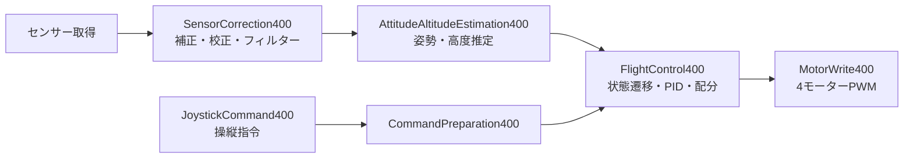

# StampFly Flight Lab — 初めての飛行からSimulinkでの制御開発へ

M5Stackの小型ドローン **StampFly** の公式飛行制御を、機能ごとに読んで編集できるSimulinkモデルへ移植したMATLABプロジェクトです。センサーから姿勢・高度を推定し、PID制御で4個のモーターを動かす流れを、実機のログと対応させて学べます。

このREADMEは、StampFlyとAtom JoyStickを購入し、自分で準備・ビルド・書き込み・初回飛行を進めたい人向けです。基本操作はMATLAB／Simulinkの画面から行います。最初の目標は **離陸 → 短いホバリング → 着陸 → ログの確認**。その後にモデルを少しずつ変更します。

制御プログラムはStampFly内のESP32-S3で **400 Hz（2.5 ms）** で動きます。PCのアプリは観測と記録を担当し、飛行中の操縦は公式JoyStickで行います。

> **配布版の状態（2026-10-16）**
> 学生向けの入口は **`StampFly_Basic400.slx`** です。PID版をコピーし、Flipの状態遷移・指令・制御分岐・専用メモリーを取り除きました。7個の専用PID、通常の離着陸、光学フロー・磁気・制御指令の記録は維持しています。光学フローと磁気は観測用で、水平位置保持には使っていません。
> 基礎版は通常飛行の比較検証とESP32-S3向けビルド、開発機への書き込み・全体照合、USBでの起動確認を完了しました。**2026-10-16にユーザーから実飛行成功の報告があります。飛行ログは未取得です。** **直下の4つの機体モデルはいずれも実モーター出力が有効**です。[基礎版の変更と確認範囲](docs/basic_flight_model.md)、[モデルの選び方](#models)、[基礎版の書き込み・飛行記録](docs/basic_aircraft_deployment.json)で版を確認してください。
> 姿勢推定を比較して学ぶためのコピー **`StampFly_IMU400.slx`** もあります。標準IMU Filterで姿勢とバイアス補正済み角速度を推定し、同じPIDへ渡します。**2026-10-16にユーザーからIMU版の実飛行成功（「問題ありません」）の報告があります。飛行ログによる数値評価は未実施です。** その後、同じモデルの階層・配線・配置を整理し、36,000周期・36出力の一致を確認してCOM4へ再書き込みしました。**整理後もユーザーから「飛行試験OKです。」と報告を受けています。飛行ログは未取得です。** 整理前の飛行成功BINと記録も保存しています。[IMU版の設定・現在の階層](docs/imu_flight_model.md)、[今回の書き込み記録](docs/imu_readability_aircraft_deployment.json)、[整理前の飛行記録](docs/imu_aircraft_deployment.json)を参照してください。

## このガイドの順序

1. [必要なものをそろえる](#requirements)
2. [機体と送信機を準備する](#hardware)
3. [MATLABプロジェクトを開く](#project)
4. [専用チャンネルを設定し、Simulinkでビルド・書き込みを行う](#build)
5. [アプリを接続して記録する](#app)
6. [初めて飛ばす](#first-flight)
7. [モデルを読んで自分で変更する](#inside)
8. [困ったとき・詳細資料](#help)

<a id="requirements"></a>
## 1. 必要なものをそろえる

### 機器

| 用意するもの | 役割 |
|---|---|
| StampFly、対応バッテリー、指定の充電器 | 飛行する機体。充電方法は製品の案内に従います |
| Atom JoyStickまたはAtom JoyStick v1.1 | 操縦・離着陸用の送信機。公式StampFly Controllerファームウェアを使います |
| データ通信対応のUSBケーブルとWindows PC | 機体・送信機・受信機の書き込みとアプリの実行 |
| 別のM5StampS3をUSB接続できる受信機 | 飛行中の無線ログをPCへ渡す機器。記録する場合に必要です |
| 平らで模様のある床、十分な照明、飛行する空間 | 下向きToFと光学フローの観測条件を整えます |

**操縦用JoyStickとログ受信機は別の機器です。** JoyStickは機体へ指令を送り、ログ受信機は機体から来るデータをPCへ渡します。受信機を用意しない場合もJoyStickで操縦できますが、飛行中のアプリ記録はできません。

複数の人が同じ場所で使う場合は、電源を入れる前に[自分のシステム専用のチャンネルを割り当てます](#radio-channel)。機体・JoyStick・ログ受信機は、そのシステム内で同じチャンネルにそろえます。


### MATLAB環境

確認環境は **MATLAB／Simulink R2026b**、**Simulink Support Package for Arduino Hardware 26.2.3** です。機体モデルはStateflowとEmbedded Coderの `ert.tlc` を使います。MATLAB、Simulink、Stateflow、Simulink Coder、Embedded Coderとその依存製品を用意してください。

`StampFly_IMU400.slx`を使う場合は、IMU Filterブロックを提供する **Navigation Toolbox** も必要です。基礎版のMadgwick姿勢推定には追加不要です。

1. MATLABの **［ホーム（Home）］→［アドオン（Add-Ons）］→［アドオンの入手（Get Add-Ons）］** を開きます。
2. **Simulink Support Package for Arduino Hardware** を検索してインストールします。
3. アドオン管理画面からサポートパッケージのセットアップを開き、ESP32-S3に必要なツールとUSB接続の準備を完了します。

アプリはプロジェクト内の `StampFlyIMUApp.m` と `StampFlyIMUApp.xml` を使います。別途アプリをインストールする手順はありません。

<a id="hardware"></a>
## 2. 機体と送信機を準備する

### 機体を机上で準備する

1. 電源を外した状態で、フレーム、モーター、プロペラ、配線を確認します。プロペラを外す場合は元の位置を控え、CW／CCWを取り違えないようにします。
2. **ビルド後の書き込みと机上確認では、機体のバッテリーとプロペラを外し、USBだけで給電します。**
3. Windowsの **［デバイス マネージャー］→［ポート（COMとLPT）］** を開き、USBを抜き差しして増減するCOMポートを確認します。
4. 機体、JoyStick、ログ受信機のポートをそれぞれ控えます。書き込み時と通常起動時でポートが変わる場合は、接続し直した後の番号を使います。

| 機器 | この開発環境での例 | 用途 |
|---|---|---|
| StampFly | COM4 | 機体プログラムの書き込み、USBでの机上観測 |
| JoyStick | COM6 | 公式送信機ファームウェアの書き込み |
| ログ受信機 | COM9 | 受信機の書き込み、アプリでの無線ログ受信 |

COM4／6／9は固定の設定値ではありません。自分のPCで確認したポートを選びます。

### JoyStickに公式ファームウェアを用意する

購入時の公式ファームウェアで操作できる場合は、そのまま使えます。初期化・更新が必要な場合は、[M5Stack公式ファームウェアガイド](https://docs.m5stack.com/en/guide/stampfly/firmware)のM5Burner手順に従います。

1. M5Burnerで **STAMPS3** の一覧から **StampFly Controller Firmware** を選びます。
2. Atom JoyStick v1.1の場合は、対応が明記された **v1.2.0以降** を選びます。この開発環境ではv1.2.0を使用しました。
3. JoyStickをUSB接続し、側面のリセットボタンを緑のランプが点くまで押し続け、離してダウンロードモードにします。
4. **［Burn］** を押し、JoyStickのCOMポートを選んで書き込みます。終了後は通常起動し直します。

JoyStickの対応バッテリーも製品の案内に従って充電し、USBを外しても操作画面が表示できることを確認します。電源の入れ方は購入したJoyStickの製品案内に従います。初回飛行までに、機体と送信機の両方の電池表示を確認してください。

機体も購入時の状態から確認したい場合は、同じ公式ガイドの **StampFly Firmware** を使って公式版で離着陸を確かめてから、後述のSimulink版へ進めます。

<a id="joystick-pairing"></a>
### 機体とJoyStickをペアリングする

プロペラを外した机上状態で行います。Simulink版を書き込んだ後も、この手順で通信を確認できます。

1. **JoyStick中央の液晶部（AtomS3／AtomS3R）のボタンを押しながら電源を入れます。**
2. ペアリングの案内が出たらボタンを離し、画面の指示に従ってもう一度押します。
3. StampFlyのリセットボタンを押して再起動し、ペアリング信号を送らせます。
4. ペアリング完了とJoyStickの操作画面を確認します。初期設定は **Stabilize／Auto Altitude、Stick Mode 2** を使います。
5. 起動時の校正が終わるまで、StampFlyを水平に置いて動かしません。完了後、手でゆっくり持ち上げ、JoyStickの **ALT** が変化することを確認します。

配布モデルの無線チャンネル初期値は **CH 3** です。複数システムで使うときは[自分に割り当てたチャンネルへ変更して書き込み](#radio-channel)、その後にJoyStickを再ペアリングします。JoyStickはペアリングで機体のチャンネルを取得します。ペアリング中は近くの他のStampFlyを停止し、自分の機体だけがペアリング信号を送る状態で行います。

ESP-NOWは機器同士の無線通信です。PCをWi-Fiアクセスポイントへ接続する操作は、この通信の準備には不要です。

**ペアリングで使う中央液晶ボタン、スティックを押し込むボタン、左右前面のボタンは別です。** 離着陸は中央液晶ボタンです。基礎版ではFlip用のスティック押し込みを無視します。

<a id="project"></a>
## 3. MATLABプロジェクトを開く

GitHubから取得する場合は[Stampfly_Flight_Lab](https://github.com/TomoakiYasukawa/Stampfly_Flight_Lab)の **［Code］→［Download ZIP］** で展開するか、Gitでクローンします。フォルダーの一部だけでなく、プロジェクト全体を取得してください。

1. MATLABの **［ホーム］→［開く（Open）］** から、直下の **`StampFly_Official.prj`** を開きます。
2. プロジェクトのファイル一覧とショートカットが表示されることを確認します。必要なパス、キャッシュ、生成コードの保存先はプロジェクトが設定します。
3. **「機体モデル（基礎版）」** を開きます。直下の **`StampFly_Basic400.slx`** をダブルクリックしても開けます。基礎版は単独で初期化でき、先に別の機体モデルを開く必要はありません。**Ctrl+D（モデル更新）** を押し、`Official.Step`などの初期値を読み込んで、診断ビューアーにエラーがないことを確認します。
4. 記録する場合は **「受信機モデル」**、表示する場合は **「ロガーアプリ」** のショートカットを使います。

アプリの起動は、プロジェクトのファイル一覧から **`scripts/setup/run_stampfly_imu_app.m`** を開き、**［実行（Run）］** を押しても行えます。このファイルがパスを準備してアプリを起動します。アプリ本体の`StampFlyIMUApp.m`と`.xml`は同じプロジェクト直下に置き、MATLABの現在のフォルダーもプロジェクト直下にします。

<a id="models"></a>
### モデルの選び方

| ファイル | 使う場面 |
|---|---|
| [StampFly_Basic400.slx](StampFly_Basic400.slx) | 学生向けの基礎版。Flipを除き、7個の専用PID、離着陸、追加センサーロギングを読む・変更する |
| [StampFly_IMU400.slx](StampFly_IMU400.slx) | 基礎版のコピー。標準IMU Filterと補正済み角速度を使う7 PID、Flipなし。階層・配線の整理後も実飛行成功の報告あり |
| [StampFly_PIDBlock_FlightTest400.slx](StampFly_PIDBlock_FlightTest400.slx) | 基礎版のコピー元。Flipを含む従来のPID比較版。元のモデルは保持 |
| [StampFly_Official_FlightTest400.slx](StampFly_Official_FlightTest400.slx) | 公式制御の比較基準。PIDは標準演算ブロックで実装され、追加の光学フロー・磁気ロギングは含まない |
| [M5Stamp_IMU_Rx.slx](M5Stamp_IMU_Rx.slx) | 別のM5StampS3へ書き込むログ受信機モデル |
| [models/StampFly_Official_Bench400.slx](models/StampFly_Official_Bench400.slx) | モーター出力を無効にした机上検証モデル。現行の追加ログすべてを含む版ではない |
| [models/StampFly_Official_FullReplay400.slx](models/StampFly_Official_FullReplay400.slx) | 保存・生成入力で公式制御と比較する再生モデル |
| [models/StampFly_Official_FlightSim400.slx](models/StampFly_Official_FlightSim400.slx) | 既知のセンサー波形に対する制御再生。機体の空力を含む閉ループ飛行シミュレーターではない |

`firmware/current/` はPID比較前の基準版、`firmware/previous_successful/` は過去の飛行成功版です。**`firmware/logging400/` はFlipを含むPID版の保存ファームウェア**で、基礎版ではありません。基礎版の書き込み済みBINは **`firmware/basic400/StampFly_Basic400.bin`**（CH 3、Revision 1601）です。基礎版を使う場合は以下のGUI手順で自分のCHを設定してビルドします。[基礎版ビルド記録](docs/basic_flight_build.json)と[書き込み記録](docs/basic_aircraft_deployment.json)で生成元を確認してください。

<a id="build"></a>
## 4. Simulinkで設定・ビルド・書き込みを行う

<a id="radio-channel"></a>
### 4-0. 自分専用の無線チャンネルを設定する

**同じ場所で使う人同士で、1システムにつき1つのチャンネルを割り当ててください。** 機体の操縦通信とログ通信は同じ無線を共有します。機体・JoyStick・ログ受信機を同じCHにそろえ、別のシステムには別のCHを使います。

現行の機体はログをブロードキャストし、受信機は同じCHの対応ログをPCへ渡します。同じCHで複数機体を動かすと、他の機体のデータが混ざり、グラフや記録が誤ったものになる可能性があります。**BuildIDが同じ機体はアプリで区別できないため、BuildIDの一致だけでは混信を防げません。**

#### チャンネルを割り当てる

1. 同じ部屋・飛行場所を使う人や担当者と相談し、使用チャンネルの一覧を作ります。「担当者・機体ラベル・CH」を記録し、機体と受信機にもラベルを付けます。
2. この実装で設定できる **1～13の整数** から、他のシステムが使っていないCHを1つ確保します。番号の近いチャンネルは電波の帯域が重なるため、可能なら **1・6・11のように離れた番号** を優先します。
3. 以下の設定箇所をすべて同じ番号にそろえます。ここでは **自分にCH 6が割り当てられた場合** を例にします。全員が例のCH 6を使うのではなく、自分の割り当てに読み替えます。

| 設定箇所 | 自分がCH 6を使う場合 | 反映する操作 |
|---|---|---|
| 基礎版の **BasicJoystick400 → Channel** | `uint8(6)` | モデル保存、機体の再ビルド・書き込み |
| 機体の **LogTransport50.m → setupImpl** | `imu_tx_init`の引数を`uint8(6)`にする | ソース保存、機体の再ビルド・書き込み |
| 受信機モデルの **ESPNowReceiverUSB → Channel** | `uint8(6)` | 受信機の再ビルド・書き込み。起動時のCHになる |
| アプリの **無線 CH** | `6` | 受信機へ接続後に **［CH を設定］** |
| 公式JoyStick | 機体からCH 6を取得 | 機体の変更後に再ペアリング |

この割り当ては同じ場所の利用者間で行うものです。周囲のWi-Fiなども同じ周波数帯を使うため、CHを分けた後も受信状況を確認します。

#### 機体側を手作業で変更する

1. 変更前のプロジェクトを別フォルダーへコピーするか、Gitで作業ブランチを作って保存します。基礎版を開き、**JoystickCommand400 → JoyStickInput400 → BasicJoystick400** を順にダブルクリックします。従来のPID版では最後のブロック名は **OfficialJoystick400** です。
2. ブロックの **Channel** を、例では **`uint8(6)`** に変更し、**［適用］→［OK］** を押します。
3. 基礎版と従来のPID版では、**DataLogging50 → RadioUSBTransport50** の送信初期化にもCH 3の固定値があります。このブロックはCHの設定欄を持たないため、MATLABのプロジェクトのファイル一覧から [code/+official/LogTransport50.m](code/+official/LogTransport50.m) を開きます。
4. **setupImpl** 内の `coder.ceval('imu_tx_init',uint8(3));` の **3だけを、自分のCHへ変更** します。CH 6の場合、その呼び出しは次の形です。

    ```matlab
    coder.ceval('imu_tx_init',uint8(6));
    ```

5. MATLABファイルと機体モデルを保存し、[4-2のビルド](#build-only)、[4-3の機体への書き込み](#aircraft-deploy)を行います。どちらの初期化が先でも同じCHになるよう、機体の2箇所をそろえてください。

**アプリのCH欄だけを変えても機体のCHは変わりません。** また、`init_official.m`の`Official.RadioChannel`や`ESPNowIMUTx.m`の既定値だけを変更しても、上記のモデル設定と固定値は置き換わりません。配布済みのBINはビルド時のCHを使うため、専用CHへ変更した機体は自分で再ビルドしたBINを書き込みます。

公式比較基準の **StampFly_Official_FlightTest400.slx** を使う場合は、**OfficialJoystick400** に加え、**DataLogging50 → ESPNowLogger50 → Channel** も同じCHに設定します。このモデルでは両方ともブロックの設定画面から変更できます。上の`LogTransport50.m`の変更は、追加ログを持つ基礎版と従来のPID版の手順です。

#### 受信機とJoyStickをそろえる

1. [4-4の受信機設定](#receiver-deploy)で **ESPNowReceiverUSB → Channel = `uint8(6)`** にして書き込みます。毎回同じCHで起動させるための設定です。
2. アプリを起動するたびに、**［無線 CH］** に自分の番号を入れ、受信機への **［接続］→［CH を設定］** を行います。アプリの初期表示は3なので、自分の番号を確認してから設定します。
3. **［CH を設定］はUSB接続中の受信機だけを切り替える操作** です。受信機の再ビルドをせず一時的にCHを切り替えることもできますが、再起動後は受信機に書き込んだモデルのCHへ戻ります。
4. 機体を再起動し、[JoyStickのペアリング手順](#joystick-pairing)をもう一度行います。JoyStickが以前のCHを記憶したままでは、新しいCHの機体と通信できません。

#### 机上で通信を確認する

プロペラとバッテリーを外し、自分の機体だけをUSB起動します。アプリで受信機のCH設定を送り、受信を確認します。機体をゆっくり傾けたり持ち上げたりして、アプリとJoyStickの値が自分の機体の動きに対応することを確認してください。

続いて自分の機体の電源を外し、残っている受信データの処理が終わった後にフレーム数の増加が止まることを確認します。周囲の他システムが稼働していても増え続ける場合は、他の機体のログを受信している可能性があります。割り当て・機体の再ビルド・受信機のCHを再確認してから飛行へ進みます。

| 確認する状態 | 次へ進む目安 |
|---|---|
| 自分の機体と受信機を起動 | 自分のCHでアプリのフレーム数が増える |
| 機体を傾ける・持ち上げる | 姿勢・ToFがその動きに対応し、JoyStickのALTも変わる |
| 自分の機体だけを停止 | 受信バッファの処理後にフレーム数の増加が止まる |
| 受信機を再起動・再接続 | 自分のCHを設定し直すと受信を再開できる |

### 4-1. 保存済みの設定を確認する

機体モデル **`StampFly_Basic400.slx`** を開き、**［モデリング（Modeling）］→［モデル設定（Model Settings）］**、または **Ctrl+E** を押します。英語名を併記しています。リリースや表示言語によってタブの位置は異なる場合があります。

| 設定画面 | 機体モデルの設定 | 受信機モデルの設定 |
|---|---|---|
| **Solver** → Type | Fixed-step | Fixed-step |
| **Solver** → Solver | discrete (no continuous states) | discrete (no continuous states) |
| **Solver** → Fixed-step size | `Official.Step`（0.0025秒） | `0.01` 秒 |
| **Hardware Implementation** → Hardware board | ESP32-S3 Series (Arduino Compatible) | 同左 |
| **Hardware board settings** → ESP32-S3 board properties → Module | ESP32-S3-WROOM-1/1U | 同左 |
| 同 → Board | ESP32-S3-DevKitC-1 | 同左 |
| **Hardware board settings** → Build options → Build action | 最初は **Build** | 最初は **Build** |
| **Code Generation** → System target file | `ert.tlc` | `ert.tlc` |
| **Code Generation** → Toolchain | ESP32 | ESP32 |

これらは保存済みモデルで確認したビルド用の設定です。通常はそのまま使い、機器に応じてCOMポートを選び直します。機体の `Official.Step` はモデル初期化で定義されます。プロジェクトを開いてモデルを読み込んでから確認してください。

<a id="build-only"></a>
### 4-2. まずビルドだけを行う

1. **Ctrl+E → Hardware Implementation → Hardware board settings → Build options** で、**Build action = Build** にします。
2. **Code Generation** の **Generate code only** が有効になっている場合は解除し、実行形式まで作れる設定にします。
3. **［適用（Apply）］→［OK］** を押し、モデルを保存します。
4. **［アプリ（Apps）］→［Embedded Coder］** を選び、**［C コード（C Code）］→［ビルド（Build）］** を押します。**Ctrl+B** でもビルドできます。
5. 診断ビューアーでビルド成功を確認します。ビルドログに表示される出力先で、基礎版なら **`StampFly_Basic400.bin`**、受信機なら **`M5Stamp_IMU_Rx.bin`** の作成日時を確認します。生成コードだけで終了していないかも確認します。

この段階では機器への書き込みを行いません。初回ビルドではライブラリーのコンパイルがあり、時間がかかります。生成コードの保存先は通常 `build/codegen/` です。BINの保存先はビルド時の現在のフォルダーや設定にもよるため、ビルドログで確認します。検証記録の `build/basic400/firmware/`、`build/logging400/`、`build/model_reorganization/` は専用ビルドスクリプトの保存先です。

<a id="aircraft-deploy"></a>
### 4-3. 自分のStampFlyへ書き込む

1. StampFlyの **バッテリーとプロペラを外した状態** を確認し、USB接続します。シリアルモニターやアプリが機体のCOMポートを使用している場合は切断します。
2. **Ctrl+E → Hardware Implementation → Hardware board settings → Host-board connection → Application download** を開きます。
3. **Set host COM port = Manually Select** を選び、**Refresh** を押して、**Host COM port** に自分のStampFlyのポートを選びます。まず **Baud rate = 921600(Default)** を使います。
4. **Build options → Build action = Build, load and run** に変更し、**［適用］→［OK］** を押します。
5. **［ハードウェア（Hardware）］** タブを開きます。タブが見えない場合は **［アプリ（Apps）］→［ハードウェア ボード（Hardware Board）］** を選び、対象が **ESP32-S3 Series (Arduino Compatible)** であることを確認します。続いて **［ビルド、展開、起動（Build, Deploy & Start）］** を押します。ビルド、機器への書き込み、実機での起動を行う操作です。**Build action = Build, load and run** を設定した後の **Ctrl+B** からも実行できます。
6. 接続待ちで進まない場合は、USBを外し、**機体StampS3の中央ボタンを押しながらUSBを接続** してダウンロードモードにします。ボタンを離し、変化したCOMポートを選び直して再実行します。必要に応じて **Prompt boot button press and release on ESP32-S3 board** の案内を有効にします。
7. 診断ビューアーで書き込み完了を確認します。必要ならリセットボタンまたはUSBの抜き差しで通常起動に戻し、水平に静置して校正を待ちます。
8. 次回の操作をビルドだけにしたい場合は、**Build actionをBuildへ戻して保存** します。

Simulinkの **［実行（Run）］** はPC上のシミュレーション操作です。機体用プログラムを作成して実機へ書き込むときは、上記のビルド・展開操作を使います。

保存されている書き込み記録は、識別済みの開発機へアプリ領域 `0x10000` を書き込み、照合した結果です。上記は自分の機器へ書き込むためのサポートパッケージ標準GUI手順であり、その操作自体の実機検証記録ではありません。公式版へ戻す場合はM5Burnerと公式ガイドを使います。

<a id="receiver-deploy"></a>
### 4-4. ログ受信機を用意する

飛行中のログをPCへ記録する場合は、この手順で別の受信機を用意します。

1. 別のM5StampS3をPCへUSB接続し、`M5Stamp_IMU_Rx.slx` を開きます。
2. 最上位の **ESPNowReceiverUSB** をダブルクリックし、**Channelを自分のCH**、**BaudRate = `uint32(921600)`** にします。CH 6ならChannelは **`uint8(6)`** です。
3. 上の設定表に従い、受信機のソルバー周期は **0.01秒** にします。ログは機体から50 Hzで送られ、受信機の100 Hz処理でPCへ渡されます。
4. **Application download** のCOMポートを、機体ではなく **受信機** のポートへ変更します。
5. 機体と同じ順序で **Build**、続いて **Build, load and run → Build, Deploy & Start** を行います。ダウンロードモードが必要なら受信機のBOOTボタンを押してUSB接続します。
6. 通常起動後、アプリから受信機のCOMポートに接続します。

JoyStickへこの受信機モデルを書き込むと操縦用ファームウェアが置き換わります。用途の表を見て、接続対象を選んでください。

<a id="app"></a>
## 5. アプリを接続して記録する

### ライブ表示

1. プロジェクトの **「ロガーアプリ」** を開き、**［モニター］** タブを選びます。
2. 受信機をUSB接続し、**［更新］** を押します。
3. **［ポート］** で受信機のCOMポート、**［通信速度 [baud]］= 921600**、**［無線 CH］= 自分に割り当てた番号** を設定します。CH 6なら6を入力します。
4. **［接続］** を押し、続いて **［CH を設定］** を押します。「CHの設定を送信」という表示は送信操作の段階です。受信機の応答が処理されると **「設定完了: CH 6」** のように表示され、その後「受信中」に変わります。
5. StampFlyを通常起動し、**「受信中」**、増え続けるフレーム数、受信周期の目安 **50 Hz** を確認します。加速度・角速度・姿勢・ToF・電池などが表示されます。
6. 終了時は、記録中なら先に **［記録停止］** を押して **「保存完了」** を確認し、続いて **［切断］** を押します。

机上では機体のUSBへ直接接続して観測することもできます。この場合は **［CH を設定］を使わず**、機体のCOMポートへ接続して観測します。**飛行中は機体のUSBを外し、USB接続した別の受信機経由で記録** します。同じCOMポートへアプリを2つ接続しないでください。

アプリの **［飛行操作・設定］** タブには旧構成由来の項目がありますが、この公式制御モデルでは **離陸・着陸・非常停止・高度設定の適用ボタンは無効** です。離着陸はJoyStickで行い、PIDなどの変更はSimulinkモデルで設定して再ビルドします。

### 記録と履歴比較

1. 離陸前に **［記録開始］** を押します。
2. 飛行終了後に **［記録停止］** を押し、**「保存完了」** を確認します。
3. 記録はプロジェクト直下の **`recordings/StampFly_日時.mat`** に保存されます。保存場所は記録状態欄のツールチップと、MATLABのコマンドウィンドウに出る **`RECORDED_MAT=...`** でも確認できます。
4. **［履歴・比較］→［一覧更新］** を押し、保存したファイルを選びます。別の場所にある記録は **［MATを追加］** で開けます。
5. **［最初の飛行］／［全記録］** で表示範囲を選びます。複数の記録を選ぶと、高度・姿勢・制御・モーター指令などを比較できます。

アプリのライブグラフは直近約10秒を表示します。記録は受信したデータを保存するので、画面外になった部分も履歴で確認できます。`recordings/` はGit管理外です。飛行ログを共有する場合はMATファイルを別途共有してください。

「保存失敗」が表示された場合は、**［保存再試行］** を押して保存完了を確認してからアプリを閉じます。

### グラフを読むときのポイント

| 表示・記録 | 意味 |
|---|---|
| 下向きToF・補正高さ | 床までの距離と、姿勢を考慮した高さ。無効な測定はグラフで空白／NaNになる |
| 制御用高度・鉛直速度 | 機体の推定器が制御に使う値。生ToFそのものとは異なる |
| 光学フローXY | 東・北方向の積算移動距離[m]。表示・記録用で、位置を固定する制御には使わない |
| 磁気 | BMM150の磁場[µT]。今回の姿勢制御・XY換算には使わない |
| モーター指令 | 計算されたPWMカウント。回転数の測定ではない |
| 補足のAppliedPWMFR／FL／RR／RL | 実際に適用したPWMカウント。旧形式では取得できずNaNになる場合がある |
| 欠落／CRC／対象外 | 通常フレームの欠落、破損、表示対象と異なるBuildIDの数 |

現行アプリは **BuildID 1401** を表示・記録対象にしています。BuildIDはプログラムの識別子で、機体固有のIDではありません。同じプログラムの複数機体が同じCHで送信すると区別できないため、[システムごとに専用CHを割り当てます](#radio-channel)。初回のペアリングと確認は対象の1機だけで行います。

光学フローの距離換算は平らな床を仮定し、**385 count/radは未校正の初期値** です。無効な区間は加算せず前の位置を保持します。精密な距離測定として扱う前に実測で校正します。[記録項目の詳細](docs/logging_extensions.md)を参照してください。

<a id="first-flight"></a>
## 6. 初めて飛ばす

### 離陸前

1. 机上確認を終えたら電源を外し、プロペラを元の正しい位置へ戻します。
2. 人や物に接触しない空間を確保し、充電した対応バッテリーを機体へ接続します。機体のUSBケーブルは外します。
3. StampFlyを平らな床に置き、起動・校正が終わるまで触りません。
4. 自分のシステムの専用CH、JoyStickとの通信、**Stabilize／Auto Altitude**、電池表示、待機状態を確認します。標準Mode 2ではスティックを中立にします。
5. 記録する場合は、受信機経由でアプリが受信していることを確認し、**［記録開始］** を押します。

### Mode 2での操作

| 操作 | 対応するボタン・スティック |
|---|---|
| 離陸／着陸 | **JoyStick中央の液晶部のボタンを押して離す** |
| 高度の目標を上下する | **左スティック上下**（Auto Altitude時） |
| 機体の向きを回す（Yaw） | **左スティック左右** |
| 前後へ傾ける（Pitch） | **右スティック上下** |
| 左右へ傾ける（Roll） | **右スティック左右** |
| Stabilize／Sportの切り替え | **左前面ボタン** |
| Auto Altitude／Manual Altitudeの切り替え | **右前面ボタン** |
| スティックの押し込み（Flip用ボタン） | **基礎版では無視され、宙返りは行わない** |

この操作表は標準 **Stick Mode 2** のものです。Mode 3を使う構成ではスティックの担当が変わりますが、基礎版ではどちらのStick ModeでもFlip用ボタンを無視します。従来のPID版と公式比較基準版にはFlipが残っているため、基礎版のモデルとBINを選んでください。

1. 待機中に中央液晶ボタンを **1回押して離す** と離陸指令になります。Auto Altitudeの初期目標高度は **0.5 m** です。
2. 上昇後は短くホバリングし、必要な分だけスティックで修正します。**このモデルには水平位置保持がない** ため、中立でも同じ床上位置へ留まるとは限りません。
3. 飛行中に中央液晶ボタンを **もう1回押して離す** と自動着陸へ移ります。
4. モーター停止と待機状態を確認してから近づきます。記録中ならアプリの **［記録停止］** を押し、保存完了を確認します。
5. バッテリーを外します。記録した場合は、履歴画面で高度、Roll／Pitch、電池、欠落／CRCを確認します。

状態はおおむね **校正 → PARKING（待機）→ FLIGHT（離陸・飛行）→ LANDING（着陸）→ PARKING** と進みます。着陸中の追加ボタン操作で待機へ移る処理もありますが、押下・解放判定を含むため、中央ボタンを「押した瞬間に停止するボタン」として扱わないでください。

<a id="inside"></a>
## 7. モデルを読んで自分で変更する

### 最上位の流れ

現行モデルを開き、まず左から右へ主信号をたどります。関連する信号は **Bus（バス）** にまとめています。バスを開く／Bus Selectorを見ると、姿勢・高度・操縦指令などの信号名を確認できます。



| 開くブロック | 中で行っていること |
|---|---|
| **IMUSensor400** | BMI270の加速度・角速度・温度を取得 |
| **BottomRangeSensor400** | 下向きToFの距離・有効性・更新状態を取得 |
| **BatterySensor400** | 電池電圧を取得 |
| **SensorCorrection400** | 軸変換、起動時のバイアス校正、IMUフィルター、ToF保持・外れ値処理、鉛直加速度 |
| **AttitudeAltitudeEstimation400** | 基礎版はMadgwick、IMU版はIMU Filterによる姿勢・角速度推定。Kalmanによる高度・鉛直速度推定とセンサーフラグは共通 |
| **JoystickCommand400／CommandPreparation400** | 無線指令を受け取り、制御で使う入力にまとめる |
| **FlightControl400** | 飛行状態、離着陸、高度・姿勢・角速度制御、モーター配分。IMU版の状態遷移Chartは最上位 |
| **MotorWrite400** | FR／FL／RR／RLのPWMを書き込む。150 kHz指定、8 bit |
| **DataLogging50** | 50 Hzで通常計測と制御・センサー補足を送信 |
| **JoystickFeedback40／LEDAndBuzzer400** | JoyStickへ状態を返信し、機体の表示・音を更新 |
| **OpticalFlowSensor400／MagnetometerSensor400／OpticalFlowDistance50** | 基礎版・IMU版・従来のPID版の追加観測。制御経路へ戻さずログへ渡す |

前向きToFは無効です。光学フローは400 Hzで差分を取り、50 Hzで距離へ換算します。磁気の新規測定は約30 Hz、下向きToFは約25 Hzで、400 Hz処理は完成した最新値を使います。

### 飛行状態とPIDを開いてみる

基礎版の **FlightControl400** をダブルクリックすると、**OfficialFlightSupervisor** のStateflow Chartがあります。状態を開いて動作、矢印を開いて遷移条件を読みます。FlipのChartと遷移は削除してあります。離着陸指令と最終モードのChartは、その中の **TakeoffHoverControl400 → FlightCommand400** にあります。

**整理済みIMU版ではOfficialFlightSupervisorは最上位にあります。** 同じ離着陸と7 PIDの制御を維持し、次のように階層を浅くしました。基礎版の階層は上記のままです。

| 統合した階層 | 現在開く場所 |
|---|---|
| EstimateLogging400 | **AttitudeAltitudeEstimation400**。推定の出口にログ用Gotoを配置 |
| FlightStatus400 | **FlightControl400**。モード・制御状態の公開と前周期へのフィードバックを配置 |
| TimeSignals400 | **TickStart400**。周期開始、実測サンプル時間、時刻変換を配置 |

IMU版の **DataLogging50** は、磁気・光学フロー・ToFをFromで受け取ります。磁気は **LogMagneticField400**、光学フローは **LogOpticalFlow400**、距離換算は **LogFlowDistance50**、下向きToFは **BottomDistanceMm** などのタグを使います。Fromのパラメーター画面の **Goto source**、または **Ctrl+F** でタグ名を検索して信号の元へ移動します。マスク付きサブシステムには表示可能な入出力端子名を付けました。内部を開く場合は右クリック **［マスク］→［マスク内を表示］** を使います。[現在の階層とタグ一覧](docs/imu_flight_model.md#整理したモデルを画面で読む)も参照してください。

**TakeoffHoverControl400** の制御経路は次の構成です。

| サブシステム | 制御の役割 |
|---|---|
| **AltitudeControl400** | 高度誤差 → 目標鉛直速度 → 共通推力の補正 |
| **AttitudeControl400** | Roll／Pitchの角度誤差 → 目標角速度 |
| **BodyRateControl400** | Roll／Pitch／Yawの角速度誤差 → 回転させるための補正 |
| **MotorAllocation400** | 共通推力と3軸の補正を4モーターへ配分・制限 |
| **FlightCommand400** | スティック目標、離着陸、高度目標、モードを決定 |
| **FlightDiagnostics400** | 制御の内部値を観測用にまとめる |

7個のPIDは、高度、鉛直速度、Roll角、Pitch角、Roll角速度、Pitch角速度、Yaw角速度です。姿勢・高度制御は入れ子になっており、外側の制御が内側の制御の目標を作ります。

### 手作業でPIDを変更してビルドする例

1. Gitの作業ブランチを作るか、エクスプローラーでプロジェクト全体を別フォルダーへコピーし、そのPRJを開いて変更前の版を残します。機体モデルの名前は **StampFly_Basic400.slxのまま** にします。モデル名に対応するタスク計測のビルド設定があるため、別名のSLXにしてビルドするにはその設定の変更も必要です。
2. 作業用のプロジェクトで **FlightControl400 → TakeoffHoverControl400 → AltitudeControl400 → AltitudePID → EnabledPID → DedicatedPID** を順に開きます。Simulinkの検索で **DedicatedPID** を探すこともできます。
3. **DedicatedPID** をダブルクリックし、PIDのパラメーター画面を開きます。現行の高度PIDは **Discrete-time、Ideal形式** です。係数欄には`single(...)`を含む式が入り、評価した値は **P = 0.38、I = 0.1、D = 0.5、N = 16** です。
4. 最初は記録を見ながら1つの係数だけを変更します。係数欄の **`single(...)`** 形式を保ち、値を編集します。**外部から入力するTs、0.0025秒の実行周期、台形積分・台形微分フィルター、外部Reset、入出力の型・バス接続** は保ちます。
5. **［適用］→［OK］**、モデル保存、**Ctrl+D（モデル更新）** の順に進み、診断ビューアーのエラーを解消します。
6. **Ctrl+E → Build action = Build** にして **Ctrl+B** を押し、生成コードとBINの作成を確認します。
7. 書き込むときは[機体への書き込み](#aircraft-deploy)へ戻り、自分の機体のCOMポートを選びます。次の飛行ログを前の記録と比較します。

元の公式係数はKp、Ti、Td、Etaで表され、現行のIdeal形式では **P = Kp、I = 1/Ti、D = Td、N = 1/(Eta×Td)** と対応します。TiをそのままI欄へ入力したり、Parallel形式へ切り替えて同じ数値を入れたりすると制御が変わります。[PID比較の詳細](docs/pid_flight_experiment.md)を参照してください。

単純な係数変更はブロックの設定画面で行えます。状態遷移を変えるときはStateflowを編集し、数値計算のMATLAB Functionが必要な箇所では、そのブロックを開いて編集します。生成されたC／C++を直接編集する代わりに、モデルを保存して再生成する流れです。

初回は接続と既存値を確認して飛行し、変更はログが取れてから行います。推定器と制御の間の **Unit Delay、リセット、Rate Transition** は更新順序を決めるため、見た目の整理だけで削除・移動しないでください。

<a id="help"></a>
## 8. 困ったとき・詳細資料

| 状況 | 確認すること |
|---|---|
| COMポートが出ない | データ通信対応USBケーブル、デバイスマネージャー、通常／ダウンロードモード、Refresh |
| 書き込みが接続待ちで止まる | 機体と受信機の取り違え、BOOT操作、切り替わったCOM番号、他のシリアル接続。必要なら書き込み速度を下げる |
| `Official.Step` やクラスが見つからない | PRJを開いているか、プロジェクト全体を取得したか。基礎版を開き直してCtrl+D。従来のPID版では公式比較基準モデルを一度開いてからPID版を開く |
| JoyStickのALTが変わらない | ペアリング、機体の校正完了、下向きToF、床面との距離 |
| アプリは接続済みだがデータが来ない | 受信機にRxモデルを書いたか、機体と受信機が自分のCHで一致するか、921600 baud、機体電源、受信フレーム数 |
| 自分の機体を止めてもデータが来る | 同じCHの他機体のログを受信していないか。専用CHの割り当てと機体・受信機の設定を見直す |
| CHを変えるとJoyStickがつながらない | 機体の2箇所を同じCHで再ビルドしたか、機体に書き込んだ後でJoyStickを再ペアリングしたか |
| 受信機の再起動後にログが来なくなる | アプリのCH変更は一時設定。受信機モデルの起動時CHを変更するか、再接続後に自分のCHをもう一度設定する |
| フレームは来るが「対象外」が増える | BuildID 1401以外のデータを受信している。対象機体とファームウェアを確認する |
| 光学フローXYが動かない | 基礎版または追加ログを持つPID版か、床の模様・照明、ToFの有効性、無効区間の保持処理 |
| グラフが空白／NaNになる | 無効フラグや取得していない項目を確認する。PWMのNaNだけでモーター停止とは判断しない |
| アプリの離陸ボタンが押せない | この構成ではJoyStickの中央液晶ボタンで操作する |
| アプリを起動できない | ロガーアプリのショートカットまたは`run_stampfly_imu_app.m`から起動したか。アプリ本体とXMLが直下にあるか、MATLABリリースが確認環境と合うか |

### フォルダー案内

| 場所 | 内容 |
|---|---|
| 直下 | PRJ、4つの機体モデル、受信機モデル、アプリのM／XML |
| `code/`、`src/` | MATLABアルゴリズム・System object、低レベルの機器ドライバー |
| `config/` | プロジェクト初期化、パス、パーティション設定 |
| `models/`、`libraries/` | ベンチ・再生モデル、学生用ライブラリー |
| `scripts/`、`tests/` | 起動・ビルド・検証・解析用コードと比較結果 |
| `docs/`、`firmware/` | 詳細説明、書き込み・検証記録、保存ファームウェア |
| `resources/project/` | MATLABプロジェクト定義 |
| `build/`、`recordings/` | 生成物、飛行ログ。Git管理外 |
| `official_sources/`、`third_party/` | 公式・依存ソースとライセンス |
| `archive/`、`tools/` | 過去の版、開発用補助ツール |

`scripts/model_edit/` はモデルを構築・整理した履歴です。現在のモデルへ一括実行するための初回セットアップではありません。`tools/deploy_*.py` も開発機のMACや履歴を前提にしているので、初めての機器では上記のGUI手順を使います。学生用ライブラリーは現行モデルへの追従が未完了です。

### 検証記録と読み進める資料

- [基礎版の変更と使い方](docs/basic_flight_model.md)、[通常制御の比較結果](docs/basic_flight_verification.json)、[基礎版ビルド記録](docs/basic_flight_build.json)、[基礎版の書き込み記録](docs/basic_aircraft_deployment.json)
- [追加センサー・記録項目・最新版の確認範囲](docs/logging_extensions.md)
- [ロギング追加前後の制御比較](docs/logging_control_verification.json)：3シナリオ・36,000周期・15出力が一致
- [機体の今回の書き込み記録](docs/imu_readability_aircraft_deployment.json)、[受信機の書き込み記録](docs/logging_receiver_deployment.json)
- [制御ブロックの読み方](docs/control_layout_and_pid.md)、[専用PIDの比較](docs/pid_flight_experiment.md)
- [IMU Filter版の座標変換・補正済み角速度・GUI設定](docs/imu_flight_model.md)
- [IMU版の階層整理の比較結果](docs/imu_readability_verification.json)、[整理版のビルド](docs/imu_readability_build.json)、[今回の書き込み](docs/imu_readability_aircraft_deployment.json)、[USB起動・処理時間](docs/imu_readability_usb_startup.json)
- [プロジェクトの検証記録](docs/matlab_project_setup.json)、[ロガー表示の検証記録](docs/logger_display_verification.json)
- [保存ファームウェアの履歴](firmware/README.md)、[移植の技術的説明](docs/official_simulink.md)

詳細文書の冒頭にある「現在の機体」や実飛行の記述は、その文書を作成した時点の状態です。現在の整理済みIMU版は `docs/imu_flight_model.md` と `docs/imu_readability_aircraft_deployment.json`、学生向けの基礎版は `docs/basic_flight_model.md`、従来の追加ロギング版は `docs/logging_extensions.md` と `docs/logging_aircraft_deployment.json` を基準に確認します。机上の数値比較・USB計測・書き込み照合と、実飛行の結果を区別して読むことができます。

## 参照元とライセンス

- [M5Stack公式ファームウェア・操作ガイド](https://docs.m5stack.com/en/guide/stampfly/firmware)
- [M5StampFly公式ソース](https://github.com/m5stack/M5StampFly)
- [Atom-JoyStick公式ソース](https://github.com/m5stack/Atom-JoyStick)
- [第三者ソースのライセンスと注意事項](docs/THIRD_PARTY_NOTICES.md)

保存した公式ソースのコミットはM5StampFly `fa7b6a59c7f297d398d381840184451dce137c48`、Atom-JoyStick `e9f53fbd8a2edd25aedf987aac2ae40a52e6bea0` です。各ソースに付属するライセンスと著作権表示を保持しています。
