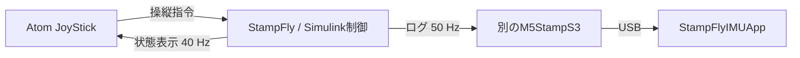

# StampFly Flight Lab

M5Stackの小型ドローン **StampFly** を使って、センサー、姿勢・高度推定、PID制御、モーター出力をSimulinkで学ぶMATLABプロジェクトです。モデルを読み、自分で設定・ビルド・書き込みを行い、飛行ログで確かめることを目指します。

現行の機体モデルは、直下の **[StampFly_IMU400.slx](StampFly_IMU400.slx)** です。標準 **IMU Filter**、MATLAB Functionの高度Kalman推定、7個のPIDを使い、**400 Hz（2.5 ms）** で動作します。光学フローによる水平速度制御・停止位置保持を追加しています。宙返り機構はありません。ほかの機体モデルは[アーカイブ](archive/README.md)へまとめています。

**現在の水平補助版は実飛行中の落下を調査中です。** 高度推定・自動記録を修正したRevision 1802は机上診断用で、飛行確認は完了していません。[調査結果と確認範囲](docs/history/horizontal_trials/20261017_fall_review.md)を先に確認してください。実飛行成功の報告がある水平補助追加前のモデル・BINは、[アーカイブ](archive/README.md)で区別しています。

## 用意するもの

| 機器 | 用途 |
|---|---|
| StampFly、対応バッテリー・充電器 | 飛行する機体 |
| Atom JoyStick／JoyStick v1.1 | 公式ファームウェアで操縦・離着陸 |
| Windows PC、データ通信対応USBケーブル | 設定、ビルド、書き込み、ログ表示 |
| 別のM5StampS3とUSB接続部 | 飛行ログをPCへ渡す受信機。記録するときに必要 |

操縦用JoyStickとログ受信機は別の機器です。PCアプリは観測・記録に使い、操縦はJoyStickで行います。

確認環境は **MATLAB／Simulink R2026b** と **Simulink Support Package for Arduino Hardware 26.2.3** です。Stateflow、Simulink Coder、Embedded Coder、Navigation Toolboxを用意します。サポートパッケージは **［ホーム］→［アドオン］→［アドオンの入手］** からインストールし、ESP32-S3のハードウェアセットアップを完了してください。[環境と依存ファイルの詳細](docs/dependencies.md)

## 準備して書き込む

1. リポジトリ全体をクローン、または **［Code］→［Download ZIP］** で取得・展開します。MATLABの **［開く］** から **`StampFly_Official.prj`** を開きます。
2. 機体モデル **`StampFly_IMU400.slx`** を開き、**Ctrl+D** でモデルを更新します。設定値とパスは自動で準備されます。
3. 機体のバッテリーとプロペラを外し、USB接続します。デバイスマネージャーで自分の機体・受信機のCOMポートを確認します。
4. 下の表で**自分専用の無線チャンネル**を設定し、モデルを保存します。
5. **Ctrl+E → Hardware Implementation** で **ESP32-S3 Series (Arduino Compatible)**、**Solver** で固定ステップ・離散・**0.0025 s**、**Code Generation** で **`ert.tlc`** を確認します。
6. **Hardware board settings → Build options → Build action = Build** にします。**［アプリ］→［Embedded Coder］→［Cコード］→［ビルド］**、または **Ctrl+B** でビルドし、診断ビューアーの成功を確認します。
7. **Host-board connection → Application download** で機体のCOMポートを選び、**Build action = Build, load and run** に変更します。**［ハードウェア］→［ビルド、展開、起動］** を押して書き込みます。
8. 通常起動へ戻し、水平に置いて校正を待ちます。次回のビルド用に **Build actionをBuildへ戻して保存** します。

受信機には **[M5Stamp_IMU_Rx.slx](M5Stamp_IMU_Rx.slx)** を使います。同じボード、離散ステップ **0.01 s**、受信機自身のCOMポートを選び、同様にビルド・書き込みします。**［実行］はPC上のシミュレーション**です。機体への書き込みには上のビルド・展開操作を使います。[画面ごとの手順・USB接続・ペアリング](docs/setup.md)

### 自分専用のチャンネルをそろえる

同じ場所で使う人・担当者と、**1システムにつき1つの未使用CH**を割り当て、機体・受信機にラベルを付けてください。設定範囲は **1～13**、初期値は **3** です。可能なら1・6・11のように離れた番号を使います。

| 設定する場所 | 変更・反映方法 |
|---|---|
| 機体 **JoystickCommand → BasicJoystick → Channel** | 自分のCHを`uint8(6)`などで入力し、機体を再ビルド・書き込み |
| 機体 **DataLogging50 → RadioUSBTransport50 → Channel** | 同じCHを入力し、機体を再ビルド・書き込み |
| 受信機 **ESPNowReceiverUSB → Channel** | 同じCHを入力し、受信機を再ビルド・書き込み |
| アプリ **無線 CH** | 接続後に自分の番号を入力し **［CHを設定］** |
| JoyStick | 機体のCH変更後に再ペアリング |

`6`は例です。全員が例の番号を使わず、自分に割り当てた番号へ読み替えます。マスク付きブロックの内部は、右クリック **［マスク］→［マスク内を表示］** から開けます。

同じCHでは他機体のログが混ざる可能性があります。**BuildIDは機体固有の識別子ではありません。** アプリのCH設定で変わるのはUSB接続した受信機だけです。機体の2か所をそろえ、再ペアリング後に自分の機体を動かして表示を確認します。

## JoyStickとアプリを使う

JoyStickは[M5Stack公式ガイド](https://docs.m5stack.com/en/guide/stampfly/firmware)に従って **StampFly Controller Firmware** を用意します。v1.1は対応版（v1.2.0以降）を使います。

プロペラを外した状態で、**中央液晶ボタンを押しながらJoyStickの電源を入れ**、画面の案内に従ってペアリングします。機体を再起動し、完了後に **Stabilize／Auto Altitude、Stick Mode 2** を確認してください。ペアリング中は自分の機体だけを起動します。

アプリはプロジェクトの **「ロガーアプリ」** ショートカット、または `scripts/setup/run_stampfly_imu_app.m` を開いて **［実行］** で起動します。

1. USB接続した**ログ受信機のCOMポート**、通信速度 **921600**、自分のCHを選びます。
2. **［接続］→［CHを設定］** を押し、設定完了の応答と増え続けるフレーム数を確認します。
3. 通常は**自動記録**です。飛行制御（Mode 2）または自動着陸（Mode 5）を受信すると開始し、直前2秒も保存します。待機へ戻った後1秒で保存完了します。接続したまま次の飛行も別ファイルへ記録します。
4. 記録は **`recordings/StampFly_日時.mat`** へ保存されます。**［履歴・比較］→［一覧更新］** で高度・速度・保存終了理由を確認します。通信途絶・時刻リセットは待機復帰と区別します。机上記録には **［記録開始］／［記録停止］** を使えます。

机上では機体のUSBへ直接接続して観測できます。この場合はCH設定を使いません。アプリの飛行操作・高度適用ボタンは無効です。[ログ項目の読み方](docs/logging_extensions.md)

## 最初の飛行

机上の通信確認後、電源を外してプロペラを正しい位置へ戻します。人や物に接触しない空間と、平らで模様のある床・照明を用意します。機体のUSBを外し、充電したバッテリーで起動して校正を待ちます。

| Stick Mode 2の操作 | ボタン・スティック |
|---|---|
| 離陸／着陸 | **中央液晶ボタンを押して離す** |
| 高度目標の上下 | 左スティック上下（Auto Altitude） |
| 向きの回転（Yaw） | 左スティック左右 |
| 前後移動（Pitch） | 右スティック上下 |
| 左右移動（Roll） | 右スティック左右 |
| Stabilize／Sport | 左前面ボタン |
| Auto／Manual Altitude | 右前面ボタン |

飛行確認が完了した版を使い、最初は **Stabilize／Auto Altitude** で、離陸 → 短いホバリング → 着陸 → ログ確認を行います。初期高度目標は **0.5 m**。飛行中に中央液晶ボタンを再度押して離すと着陸へ移ります。中央ボタンは押した瞬間の停止ボタンではありません。現在の調査中版では飛行を再開しないでください。

**水平補助**はStabilize／Auto Altitudeで、高さ0.20 m以上・正常な測定・スティック中立が0.5秒続くと有効になります。右スティックは機首基準の速度指令となり、移動中も水平速度を制御します。離すと減速し、**止まった新しい位置**を保持します。初期速度上限は0.3 m/sです。

アプリの **「水平補助」** で保持・移動・減速・復帰待ちと速度目標を確認します。フロー・ToFが無効になると従来の傾き操縦へ移り、正常測定と中立が1秒続いてから現在位置を取り直します。Sport／Manual Altitudeでは従来操縦です。磁気によるYaw補正は今後の別工程です。[条件・設定と検証範囲](docs/horizontal_control.md)

履歴の0秒は**飛行制御開始**で、モーター立上げも含みます。負の時刻は直前記録です。鉛直速度は上昇が＋、単位m/s。Kalman速度をPIDへ直接渡し、ToF高度変化率は比較用に表示します。

スティック押し込みの宙返り操作は使いません。停止を確認してからバッテリーを外してください。

## モデルを読む

最上位の **IMUSensor → SensorCorrection → AttitudeAltitudeEstimation → FlightControl → MotorWrite** が主経路です。飛行状態は最上位の **OfficialFlightSupervisor** で判断し、観測データは名前付き **Goto／From** で **DataLogging50** へ渡します。

水平推定は最上位の **HorizontalMotionEstimation**、速度目標・PI・傾き選択は **FlightControl → TakeoffHoverControl → AttitudeControl → HorizontalControl** にあります。各処理の設定画面に日本語の説明を表示します。

MATLAB Functionには概要と機能別の日本語コメント、主要ブロックには日本語の説明と端子名があります。PIDの変更は **FlightControl → TakeoffHoverControl → 各制御 → 各PID → DedicatedPID** の設定画面から行い、更新・保存・再ビルドします。[階層・推定手法・配列の順序](docs/imu_flight_model.md)

`code/`、`src/`、`third_party/`に必要な独自コード・ドライバーを同梱しています。生成物は`build/`、記録は`recordings/`、過去モデルは`archive/`です。[開発・実験の履歴](docs/history/README.md)に過去の試行と検証記録をまとめています。
