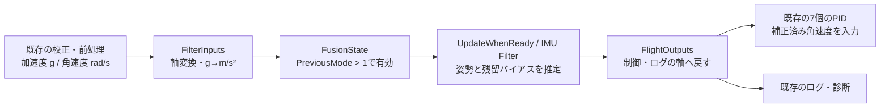

# StampFly_IMU400 — 標準IMU Filterで姿勢と角速度を推定する

プロジェクト直下の **[StampFly_IMU400.slx](../../StampFly_IMU400.slx)** は、飛行試験済みの基礎版 `StampFly_Basic400.slx` のコピーです。`MadgwickAttitude`をMathWorksの標準 **IMU Filter** ブロックに置き換えました。元の基礎版ファイルは変更していません。2026-10-16に開発機（COM4）へIMU版を書き込み、全体照合とUSB起動確認を完了し、その後ユーザーから **「実機飛行しました。問題ありません。」** と報告を受けました。飛行ログによる数値評価は行っていません。

推定アルゴリズムを比較するモデルです。起動時の静止校正、センサー前処理、7個のPIDと係数、高度推定、離着陸、モーター配分、通信、ログ形式は基礎版を引き継ぎ、Flipを含みません。姿勢推定値とPIDへ渡す角速度が変わるため、同じ操縦入力でもモーター指令が基礎版と完全一致することは目的にしていません。

実飛行後に同じファイルの階層と配置を整理し、比較検証・ESP32-S3ビルドを通してCOM4へ書き込みました。整理前の飛行成功版は `firmware/imu400/`、整理後は `firmware/imu400_readability/` に保存しています。以下の階層説明は現在の整理済みモデルを対象にします。2026-10-16に整理後もユーザーから **「飛行試験OKです。」** と報告を受けました。飛行ログによる数値評価は行っていません。

その後、高度推定も標準ブロックへ置き換えた別コピー **[StampFly_KF400](kf_flight_model.md)** を追加し、現在のCOM4はKF版（Revision 1801、CH 3）です。このIMUモデルと飛行成功BINは比較・復元用に保持しています。KF版は比較・ビルド・書き込み・USB確認まで完了し、実飛行は未実施です。

## 整理したモデルを画面で読む

最上位では、センサー取得、補正、推定、操縦指令、制御、モーター出力を左から右へ読みます。**OfficialFlightSupervisor** のStateflowは最上位にあり、飛行モードの判断を制御サブシステムに入らず確認できます。推定器と制御へ戻る前周期の値は **PreviousCycle400** を通ります。

| 開く場所 | 整理後の内容 |
|---|---|
| **TickStart400** | 周期開始時刻、実測サンプル時間、秒への変換と時刻ログのGotoをまとめています。旧TimeSignals400はここへ統合しました |
| **AttitudeAltitudeEstimation400** | IMU姿勢推定、高度・鉛直速度推定、センサーフラグに加え、推定値をログへ公開するGotoを配置しています。旧EstimateLogging400の階層を解消しました |
| **OfficialFlightSupervisor**（最上位） | INIT、AVERAGE、PARKING、FLIGHT、LANDINGの状態遷移。通信断、過大加速度、離着陸ボタンの判断を読みます |
| **FlightControl400** | Supervisorの判断を使い、離着陸、7 PID、モーター配分、制御状態のログ公開と次周期へのフィードバックを行います。旧FlightStatus400の階層を解消しました |
| **DataLogging50** | Fromで取得したデータを50 Hzの3種類のパケットへまとめ、送信します。磁気・光学フロー・距離換算の長い最上位配線をGoto/Fromへ置き換えました |

磁気・光学フロー・ToFは、次のタグで書き込み元と読み出し先をたどれます。同じタグ名の **Goto → From** が信号の受け渡しです。端子をなくしてもデータの型と値は変えていません。

| Goto/Fromのタグ | 元のデータ |
|---|---|
| `LogOpticalFlow400` | OpticalFlowSensor400の差分、観測状態、積算値 |
| `LogMagneticField400` | MagnetometerSensor400の磁場、フラグ、診断 |
| `LogFlowDistance50` | OpticalFlowDistance50の東北方向位置、使用フラグ、移動量 |
| `BottomDistanceMm`、`BottomRangeFresh`、`BottomRangeStatus`、`BottomToFDiagnostics` | 下向きToFの距離、更新状態、測定状態、診断。既存のGoto/Fromを維持しています |

**DataLogging50** を開き、たとえば **ReadLogMagneticField400** を選んでパラメーター画面の **Goto source** から送信元へ移動します。見つからない場合はSimulinkの検索 **Ctrl+F** でタグ名を探します。From/Gotoの参照を使うと、長い配線を目で追わずにデータの出所を確認できます。

マスク付きサブシステムでは、表示可能なブロックに入出力端子名を付けました。バス端子の名前を起点に内部を読みます。標準PIDとStateflowのアイコンはそれぞれの表示を保っています。マスクがあるブロックの内部は右クリック **［マスク］→［マスク内を表示］（Look Under Mask）** で開けます。

## モデルを開いてIMU Filterを設定する

1. MATLABで `StampFly_Official.prj` を開き、プロジェクトのショートカット **「機体モデル（IMU Filter）」** を選びます。直下の `StampFly_IMU400.slx`をダブルクリックしても開けます。Navigation Toolboxが必要です。
2. **AttitudeAltitudeEstimation400 → IMUAttitude400 → FusionState → UpdateWhenReady → IMU Filter** を開きます。標準ブロックのパラメーター画面で推定設定を変更できます。
3. 以下の設定を確認し、**［適用］→［OK］** を押します。サンプルレートはモデルの2.5 ms周期から400 Hzとして継承されます。
4. **Ctrl+D（モデル更新）** を押し、エラーがないことを確認して保存します。

| パラメーター | このモデルの設定・意味 |
|---|---|
| Reference frame | **NED**。従来の推定器へ渡していた軸と重力の符号を合わせる |
| Orientation output format | **quaternion**。標準ブロックは1×4のWXYZ、制御・ログへは4×1に整える |
| Decimation factor | **1**。毎周期に姿勢と角速度を出力する |
| Initial process noise | `IMUFlight.InitialProcessNoise`。9×9の初期共分散 |
| Accelerometer noise | `IMUFlight.AccelerometerNoise`。単位は(m/s²)² |
| Gyroscope noise | `IMUFlight.GyroscopeNoise`。単位は(rad/s)² |
| Gyroscope drift noise | `IMUFlight.GyroscopeDriftNoise`。角速度バイアスの変動モデル |
| Linear acceleration noise | `IMUFlight.LinearAccelerationNoise`。重力以外の加速度のモデル |
| Linear acceleration decay factor | `IMUFlight.LinearAccelerationDecayFactor` |
| Simulate using | **Code generation** |

`scripts/setup/init_imu_flight.m`が`IMUFlight`を初期化します。ノイズ設定はまず`imufilter`の既定値を使い、実機の飛行ログで調整する前提です。画面の式を数値へ変更すれば、そのモデルに保存できます。既定値がBMI270の振動条件に最適化されていることまでは確認していません。

自分で同じ置換を行う場合は、ライブラリブラウザーの **Navigation Toolbox → Sensor Fusion and Tracking → IMU Filter** からブロックを追加します。入力の単位、行列の形、リセット・有効化、制御側の軸変換をこのコピーと比較して確認します。完成済みコピーを使う場合、構築用スクリプトを実行する必要はありません。

## 入出力と内部の流れ

`FilterInputs`は加速度と角速度を従来の推定器と同じ **[bodyY, bodyX, −bodyZ]** に変換します。加速度はgからm/s²へ9.80665倍し、角速度はrad/sのままです。IMU Filterには1×3のsingle行列を渡します。

`FlightOutputs`はクォータニオンから角度を求め、従来の **[pitch, roll, −(yaw + π)]** の順序とヨーオフセットを維持します。従来実装の丸めた度・ラジアン換算係数も維持しています。IMU Filterの角速度は **[filterY, filterX, −filterZ]** に戻し、`Attitude.AngularRate`として既存の角速度PIDへ渡します。姿勢・角速度・ログの配列サイズとsingle型は従来どおりです。

起動時の姿勢角はゼロ、クォータニオンは単位姿勢です。推定は従来と同じ`PreviousMode > 1`で実行し、停止中は角度と姿勢を保持します。リセットは姿勢を初期化し、角度は次の推定更新まで保持します。停止中に受けたリセット要求は次の更新前にIMU Filterへ反映し、フィルターのバイアス・共分散も初期化します。IMU Filterは最初の加速度から傾きを初期推定するため、この初期収束はMadgwickと同一ではありません。

## PIDに補正済み角速度を使う理由

従来の静止校正で大きなオフセットを除いた後にも、温度変化などによる残留バイアスがあります。IMU Filterは姿勢とこの残留バイアスを合わせて推定し、角速度から差し引きます。その出力をPIDへ渡すことで、実際には回転していないのにPIDが回転を検出する誤差を減らします。

Decimation factorを1にした角速度出力は、入力から推定バイアスを差し引いた値です。別の低域フィルターや1周期の遅延を追加していません。起動校正中は補正量ゼロで元の角速度を通し、推定を停止したときは最後の補正量を保持して新しい角速度へ適用します。

補正の良さはノイズ設定と観測条件に依存します。並進加速度や振動を傾き・バイアスと取り違える可能性もあるため、係数は実機ログで評価します。**磁気は従来どおり観測ログ用で、IMU Filterへ入力しません。** 加速度とジャイロだけでは絶対方位を決められず、水平静止状態のヨー方向バイアスも識別できません。3軸すべてのドリフトが解消するとは限りません。

## 画面からビルドする

1. [READMEの専用チャンネル設定](../../README.md#???????????????)に従い、自分の機体・JoyStick・ログ受信機のCHをそろえます。IMU版も **JoystickCommand400 → JoyStickInput400 → BasicJoystick400 → Channel** と、`code/+official/LogTransport50.m`の送信初期化を設定します。保存版はCH 3を継承しています。
2. IMU版を開いて **Ctrl+E → Hardware Implementation → Hardware board settings → Build options** を開き、**Build action = Build** にします。ハードウェアは基礎版と同じESP32-S3設定を使います。
3. **Code Generation → System target file = ert.tlc**、**Generate code onlyが無効**、固定ステップ **0.0025 s**を確認し、**［適用］→［OK］**、保存の順に進みます。
4. **［アプリ］→［Embedded Coder］→［C コード］→［ビルド］**、または **Ctrl+B** を押します。ビルドログに示すフォルダーで **`StampFly_IMU400.bin`** の生成を確認します。

モデル名`StampFly_IMU400`に対応した400 Hzタスク計測を追加しています。この名前を保ってビルドしてください。機体へ書き込む手順、COMポート確認、プロペラを外す机上確認は[README](../../README.md#????????)にあります。

ログのBuildIDは互換性のため **1401**、FirmwareRevisionはIMU版を区別する **1701**です。既存のアプリと受信機を使えます。ログ項目の`FilteredGyro`にはIMU版ではPIDへ渡す補正済み角速度が入り、生ジャイロの記録は引き続き残ります。互換性用の`RawMadgwickQuaternion`という旧診断名には、IMU版のWXYZクォータニオンが入ります。

## 確認した範囲

| 確認 | 結果・記録 |
|---|---|
| 起動校正中の保持 | 姿勢角ゼロ・単位クォータニオン、更新前の角速度の通過を確認 |
| 静止と正負傾斜 | 水平と±0.25 radの各軸傾斜で、軸・符号・角度・single型・単位クォータニオンを確認 |
| 3軸回転 | 0.3 rad/sの区間入力で角速度・姿勢の向きを確認 |
| 残留バイアス補正 | 水平静止で[0.03, −0.02, 0] rad/sを与え、30秒後の補正済み平均が約[−4.9, 3.1, 0]×10⁻⁶ rad/sへ減少 |
| モード保持・リセット | 推定停止中の保持、停止中のリセット、再開、複数周期のリセットを確認 |
| 推定以外の処理 | 749ブロックでパラメーター・処理・配線の一致を確認 |
| 同じ推定値での制御比較 | 3シナリオ・36,000周期でモーター指令、飛行モード、前処理、診断など15出力とデータ型が完全一致 |
| モデル全体・ESP32-S3ビルド | 成功。2.5 ms、PWM 150 kHz・8 bit、7 PID、Revision 1701を確認 |
| ログ形式の互換性 | 190 / 190 / 246 byteの3種類。RevisionとCRC以外は基礎版と一致し、旧Flip予約領域はゼロ |
| 実機書き込み・USB起動 | COM4へアプリ領域986,656 byteを書き込み、全体digest一致。15秒間でRevision 1701、待機モード3、PWMゼロ、CRCエラーゼロ、正常なクォータニオンを確認 |
| 実機400 Hzタスクの処理時間 | 6,000周期、平均約1.613 ms、最大2.552 ms。2.5 ms超過2回、取りこぼしゼロ。全周期の期限内完了は達成していない |
| 整理前の実飛行 | 2026-10-16にユーザーが「実機飛行しました。問題ありません。」と報告。飛行ログによる数値評価は未実施 |

[姿勢・バイアス・保持動作の検証記録](imu_flight_verification.json)、[制御比較の検証記録](imu_control_verification.json)、[ESP32-S3ビルド記録](imu_flight_build.json)に結果を保存します。推定器の試験は実際の保存済みブロックをコピーしたオフラインモデルで行い、制御比較は同じ姿勢・角速度を両版へ入力します。

上表のビルド・USB結果は整理前のIMU版です。[整理前の書き込み・飛行記録](imu_aircraft_deployment.json)と[整理前のUSB起動・処理時間](imu_usb_startup.json)を保持しています。基礎版（Revision 1601）も書き込み前に機体とのdigest一致を確認し、復元用BINを保存しています。

### 階層整理後の確認

| 確認 | 結果・記録 |
|---|---|
| 保存済みモデルの整理前後比較 | 起動・離着陸、モード、センサー更新・中断の3シナリオ、計36,000周期。実際の推定器とStateflowを含む36出力の値・型・サイズが完全一致 |
| Supervisorと時刻 | Stateflowの状態・遷移・データ・遷移優先順位が一致。周期開始ブロック、実行優先順位、時刻変換とタグを維持 |
| ログ経路 | 保存済みDataLogging50全体を比較。磁気・光学フロー・ToFの非ゼロ入力で3種のパケットとCRCが一致 |
| ビルド・書き込み | 986,400 byteのアプリ領域をCOM4へ書き込み、独立した全体digest照合が一致。2.5 ms、7 PID、CH 3、Revision 1701 |
| USB起動・待機出力 | 15秒の再計測でCRCエラーゼロ、待機モード3、PWMゼロ、有限の推定値、単位クォータニオン |
| 400 Hzタスクの処理時間 | 再計測6,000周期、平均1.611 ms、最大2.546 ms、2.5 ms超過3回、取りこぼしゼロ |
| 整理後の実飛行 | 2026-10-16にユーザーが「飛行試験OKです。」と報告。飛行ログは未取得で、飛行中の数値評価は未実施 |

[整理前後の検証](imu_readability_verification.json)、[整理版のビルド](imu_readability_build.json)、[今回の書き込み](imu_readability_aircraft_deployment.json)、[USB起動・処理時間](imu_readability_usb_startup.json)に保存しています。**現在の機体はこの整理済みIMU版です。** BuildIDとRevisionは整理前と共通なので、BINとモデルのSHA256で版を区別します。直前の飛行成功IMU版は、書き込み前に機体とのdigest一致を再確認して復元用に保存しました。

初回のUSB受信ではSFIYパケットが2件途中で切れ、CRCエラーになりました。ファームウェアを変更せず再計測した15秒では全3種でCRCエラーゼロでした。[初回記録](imu_readability_usb_attempt1.json)も残しています。USB転送の原因は特定していません。

USB机上確認はバッテリー・プロペラを外し、IMU Filterを更新する待機モード3で行いました。少数の期限超過があり、400 Hzで全周期が2.5 ms以内に完了する保証はありません。整理後の実飛行成功はユーザー報告で確認しました。飛行中の姿勢・角速度・処理時間はログによる数値評価をしていません。次の飛行ではアプリからログを記録し、これらを比較できます。

MathWorks資料: [imufilter](https://jp.mathworks.com/help/nav/ref/imufilter.html)、[IMU Filterブロック](https://jp.mathworks.com/help/nav/ref/imufilterblock.html)。
