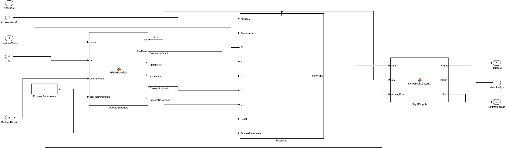
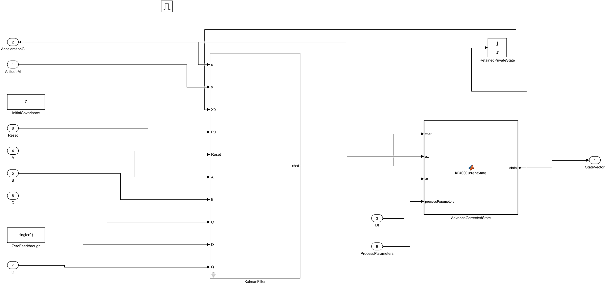

# StampFly_KF400 — 標準Kalman Filterで高度を推定する

直下の **[StampFly_KF400.slx](../../archive/kf400/StampFly_KF400.slx)** は、実飛行成功の報告がある整理済み `StampFly_IMU400.slx` のコピーです。`AttitudeAltitudeEstimation400 → AltitudeKalman` の独自計算を、MathWorksの標準 **[Kalman Filter](https://jp.mathworks.com/help/control/ref/kalmanfilter.html)** に置き換えました。モデル全体の配置を引き継ぎ、追加部分の配線と端子表示を整理しています。

このコピーもFlipを含みません。IMU FilterとPIDへ渡す補正済み角速度、7個のPIDと係数、離着陸、モーター配分、通信、ログ形式はIMU版を引き継ぎます。高度推定の単位、ToF前処理、Q/R、実測dt、更新周期、待機時の状態保持も維持します。標準ブロックと元のsingle計算では丸め方が異なるため、推定値とモーター指令の完全な一致は前提にしていません。

**比較・ESP32-S3ビルド・COM4への書き込み・独立した全体digest照合・USB起動確認まで完了しました。** 現在の開発機は **Revision 1801、BuildID 1401、CH 3** です。新しいコピーの実飛行は未実施です。既に飛行成功した復元用ファームウェアは `firmware/imu400_readability/StampFly_IMU400.bin`（Revision 1701）です。

## 画面でモデルを読む

1. MATLABで **`StampFly_Official.prj`** を開き、直下の **`StampFly_KF400.slx`** をダブルクリックします。Navigation Toolboxと、標準Kalman Filterを提供するControl System ToolboxまたはSystem Identification Toolboxが必要です。
2. **Ctrl+D（モデル更新）** を押して初期値を読み込みます。モデル初期化で `scripts/setup/init_kf_flight.m` が実行され、`AltitudeKF` を設定します。
3. **AttitudeAltitudeEstimation400 → AltitudeKalman** を開きます。左から、更新可否と行列を作る **UpdateSchedule**、標準フィルターを含む **FilterStep**、公開出力を保持する **FlightOutputs** を読みます。
4. **FilterStep → KalmanFilter** をダブルクリックすると、標準ブロックの設定画面を開けます。**AdvanceCorrectedState** は現在周期の推定値への変換、**RetainedPrivateState** はリセット時に残す内部状態です。



最上位のStateflow、TickStart400、PreviousCycle400、Goto/Fromによるログ公開は整理済みIMU版と共通です。[階層・センサータグの読み方](../imu_flight_model.md)を参照してください。

## Kalman Filterの設定

自分で同じ標準ブロックを配置する場合は、ライブラリブラウザーで **Control System Toolbox → State Estimation → Kalman Filter** を選びます。ライブラリ検索で `Kalman Filter` を探す方法もあります。完成済みコピーを使う場合は、構築用スクリプトの実行は不要です。

| 設定画面の項目 | このモデルの設定 |
|---|---|
| Time domain | **Discrete-Time** |
| Use current measurement y[n] to improve xhat[n] | **on** |
| Model source | **Input port** |
| Number of states / inputs / outputs | **3 / 1 / 1** |
| Sample time | **`AltitudeKF.SampleTime`**（0.0025 s） |
| Initial estimate source | **Input port**。X0に保持した内部状態、P0に初期共分散を接続 |
| Time-invariant Q | **off**。実測dtに応じたQを端子へ接続 |
| R / Time-invariant R | **`AltitudeKF.MeasurementVariance` / on** |
| N / Time-invariant N | **`zeros(3,1,'single')` / on** |
| Specify G and H | **off**。G=I、H=0を使用 |
| Add input port u | **on** |
| Add input port Enable | **off**。外側のEnabled Subsystemで更新全体を止める |
| External reset | **Level hold** |
| Output estimated y / covariance | **off / off**。飛行用にはxhatを使用 |

設定を変更したら **［適用］→［OK］→Ctrl+D** の順で確認し、モデルを保存します。入力端子の順序は **u、y、X0、P0、Reset、A、B、C、D、Q** です。標準ブロックを大きく表示し、各端子名を確認して接続します。



## 行列と出力時刻

内部状態は **`[鉛直速度; 高度; 加速度バイアス]`**、外部への出力端子は **高度・速度・バイアス** です。実測周期を `h=dt` とすると、元の予測式は次の行列に対応します。

```matlab
A = [1 0 -h; h 1 0; 0 0 1-0.01*h];
B = [h; 0; 0];
C0 = [0 1 0];
Q = diag([0.01*h^2, 0, h^2]);
R = 0.004^2;
```

元の実装は現在の加速度で予測した後、現在のToF高度で補正し、その結果を同じ周期に出力します。標準ブロックの現在推定器は観測補正の後に入力uで次周期へ進むため、**ブロックには `C=C0*A=[h 1 0]`、D=0を渡し、外側で `A*xhat+B*az` を計算**します。これにより現在のdtと加速度を使う元の更新順序に合わせています。

この簡単な変換は **`Q*C0'=0`** に依存します。高度方向のプロセスノイズ、`0.5*h^2` の加速度項、D、ノイズ相関を後から追加する場合は、出力時刻の対応も再検討してください。[置換前の検討](altitude_kalman_replacement_review.md)に式と背景を記録しています。

## 更新停止とリセット

| 条件 | 維持した動作 |
|---|---|
| PreviousModeが0・1 | 予測も観測補正も停止。内部状態・共分散・出力を保持 |
| 最初の有効周期、PARKING（モード3）への遷移 | 更新全体を1周期省略 |
| ParkingReset | 公開出力をゼロ、共分散を100Iへ戻す。**内部状態は保持** |
| PARKING中の継続周期 | リセット要求が続き、有効周期ごとにリセット後の推定を行う |
| 更新停止中のリセット | 公開出力をゼロにし、共分散リセットを次の有効更新まで保持 |

標準ブロックのEnableは観測補正だけを止める機能です。このモデルは外側の **FilterStep** 全体を有効・無効にして予測も停止します。Resetの **Level** は非ゼロからゼロに戻る周期にもリセットするため、継続要求中だけリセットする **Level hold** を使います。

## 係数を自分で変更する

**AltitudeKalman → ProcessParameters** の定数は `AltitudeKF.ProcessParameters=single([0.01;1;0.01])` です。順に速度のプロセス分散係数、バイアスのプロセス分散係数、バイアス減衰係数を表します。**FilterStep → InitialCovariance** は `100*eye(3)` です。

GUIで1つのモデルだけを調整する場合は、定数ブロックやKalman Filterの設定欄の式を希望するsingle値へ変更し、**［適用］→［OK］→モデル保存→Ctrl+D** を行います。既定値全体を変更する場合は、MATLABのプロジェクトファイル一覧から **`scripts/setup/init_kf_flight.m`** を開いて編集します。変数をコマンドウィンドウで変更するだけでは、モデル初期化で既定値へ戻ります。

Rの初期値は4 mm相当の標準偏差の二乗です。今回の置換は元の設定を維持するためのもので、実機ノイズへの最適化は行っていません。調整はログを取り、1項目ずつ比較します。

高度用加速度は、従来どおりオフセット補正した機体Z成分の **g数値をそのまま積分**しています。SI単位として整合していません。姿勢を使った地球座標の鉛直への変換、重力除去、ToFの傾き補正も追加していません。速度とバイアスの値は従来と同じ数値尺度です。これらの改善はQ/Rの再調整と合わせて別途検討します。

ToFは約25 Hzで取得し、保持・前処理した高度を有効な400 Hz周期ごとに観測します。新着ToFのときだけ補正する方式へは変更していません。

## 画面からビルド・書き込みする

1. **`StampFly_KF400.slx`** を開き、[READMEの専用チャンネル設定](../../README.md#???????????????)に従って、自分に割り当てたCHへ機体・送信機・ログ受信機をそろえます。配布版の初期値はCH 3です。機体の **BasicJoystick400 → Channel** と **LogTransport50.mの送信初期化** の両方を変更します。
2. **Ctrl+E →［ソルバー］** で固定ステップ・離散、ステップ **`Official.Step`（0.0025）** を確認します。**［ハードウェア実行］** は **ESP32-S3 Series (Arduino Compatible)**、コード生成は既存の **ert.tlc** を使います。
3. **［ハードウェア実行］→［ターゲット ハードウェア リソース］** のBuild actionを **Build** にし、**［適用］→［OK］**、モデル保存、**Ctrl+B** を押します。診断ビューアーでビルド成功と **`StampFly_KF400.bin`** の出力先を確認します。
4. アプリから機体のCOM接続を切断し、バッテリーとプロペラを外してUSB接続します。デバイスマネージャーで機体のCOMポートを確認します。
5. 設定画面でBuild actionを **Build, load and run** に切り替え、機体のCOMポートを選びます。**［ハードウェア］→［ビルド、展開、起動（Build, Deploy & Start）］** を押します。詳細は[READMEの書き込み手順](../../README.md#????????)を参照してください。
6. 通常起動後は水平に静置して校正を待ち、アプリでCH、フレーム、姿勢・高度・速度、待機時PWMを確認します。初回の実飛行ではアプリの **［記録開始］** を使い、短いホバリング・着陸・再離陸の記録を残します。

アプリの通信・ログ形式は共通なので、受信機の書き換えは今回の推定器置換だけでは必要ありません。専用CHを変更した場合は、受信機設定とJoyStickの再ペアリングも行います。

## 比較の結果と確認範囲

保存済みの旧・新高度推定ブロックを4ケース、各30秒、合計 **48,004周期** 比較しました。初回、dt変動、ToF保持・急変、待機・着陸・再離陸、モード0/1での保持、停止中リセットを含みます。

| 比較 | 最大差・結果 |
|---|---|
| 新推定器と倍精度の元の式：高度 | **0.000000598 m** |
| 新推定器と倍精度の元の式：速度 / バイアス | **0.000221 / 0.00254**（従来の数値尺度） |
| 全体3ケース、36,000周期・36出力：高度 | **0.00002094 m** |
| 全体比較：速度 / バイアス | **0.02144 / 0.04519**（従来の数値尺度） |
| 全体比較：計算duty / 適用PWM count | **0.0004216 / 最大1 count**（8 bit） |
| 姿勢・角速度・センサー入力・モード・フィードバック | **一致** |
| 高度推定外の構造・パラメーター・配線 | **778ブロックを比較、一致** |
| 完全なログパケット | **190 / 190 / 246 byte、CRC・予約領域・非ゼロの追加センサー値を確認** |

PARKING後に前処理を通さず高度を急変させた単体ケースでは、旧新の最大差が高度5.61 mm、速度2.12、バイアス22.90になりました。倍精度の同じ式との照合により、主因は元のsingle共分散の減算による桁落ちと確認しました。標準ブロックはJoseph形式で共分散を更新し、倍精度基準への誤差が小さくなっています。入力・更新・リセットのタイミングは維持しています。実際の前処理とPIDを含む全体比較では、上表の差でした。

これは保存モデルのオフライン比較です。実機での高度精度・飛行中の処理時間・飛行成功は別の確認です。USBの待機時計測だけで飛行中の全周期が2.5 ms以内と判断しないでください。

2026-10-16（日本時間）にアプリ領域 `0x10000` へ **990,240 byte** を書き込み、別の照合操作でdigest一致を確認しました。アプリのSHA256は `3a44dc01f9b3f4ed0ec832977fa473a202781f625103a5fb22dec6911e89de61`、保存モデルは `7b4bfddfafad0d0a53b8b4ec998ce1f5f3be061954af273ab40c8e1d08045a0a` です。ビルド前の元のIMUモデルは変更していません。飛行成功IMU版も書き込み前に機体と照合して保存しました。

2026-10-17のUSB確認は15秒間で **SFI8 751、SFIX 750、SFIY 750フレーム、CRCエラーゼロ**。Revision 1801・BuildID 1401、待機モード3、適用PWMゼロ、有限の高度・速度・バイアスと正常な単位クォータニオンを確認しました。待機中のバイアスは継続する共分散リセットのためゼロです。この確認では飛行指令を送っていません。

| 400 Hz全体タスクのUSB待機時計測 | 整理済みIMU版 | KF版 |
|---|---|---|
| 周期数 | 6,000 | 6,000 |
| 平均処理時間 | 1.611 ms | **1.770 ms** |
| 最大処理時間 | 2.546 ms | **2.699 ms** |
| 2.5 ms超過 | 3回 | **4回** |
| Tick取りこぼし | 0 | **0** |

平均処理時間は約0.160 ms増えました。**全周期の2.5 ms以内完了は達成していません。** 更新には実測dtを使い、取りこぼしはありませんでしたが、実飛行中の負荷はまだ測定していません。短い飛行・着陸・再離陸のログで高度とタスク時間を確認する段階です。

| 記録 | 内容 |
|---|---|
| [kf_flight_structure.json](kf_flight_structure.json) | 保存モデル・標準ブロック設定・配置 |
| [kf_altitude_verification.json](kf_altitude_verification.json) | 4ケースの単体比較・保持・リセット |
| [kf_altitude_numerics.json](kf_altitude_numerics.json) | 倍精度基準との照合 |
| [kf_flight_verification.json](kf_flight_verification.json) | PID/PWM・構造・ログ、数値差の合格判断 |
| [kf_flight_build.json](kf_flight_build.json) | ESP32-S3ビルド・BINの識別 |
| [kf_aircraft_deployment.json](kf_aircraft_deployment.json) | 開発機へのアプリ領域書き込み・全体照合 |
| [kf_usb_startup.json](kf_usb_startup.json) | 起動・CRC・待機PWM・推定値・400 Hz処理時間 |
| [kf_project_registration.json](kf_aircraft_deployment.json) | MATLABプロジェクトの登録とチェック |

`scripts/verification/` の比較・解析スクリプトは検証を再実行するためのものです。`scripts/model_edit/` の作成スクリプトはモデル構築の履歴で、初回セットアップとして実行するものではありません。`tools/deploy_kf_firmware.py` はこの開発機の識別と保存済み履歴を確認して書き込むためのものです。初めての機器には上記のSimulink GUI手順を使います。
