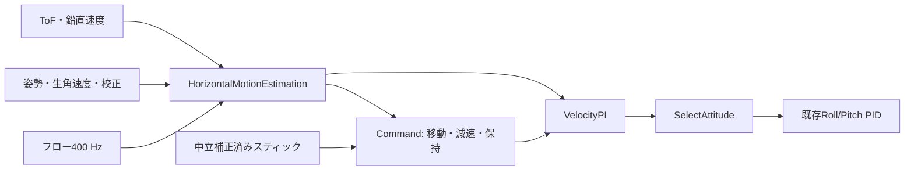

# 光学フローによる水平補助

`StampFly_IMU400.slx`の水平補助は、**移動中も速度を制御し、中立後は減速して停止位置を保持**します。既存7個の姿勢・角速度・高度PIDの内部と係数は維持し、その前段のRoll／Pitch目標を作ります。磁気によるYaw補正・絶対位置・自動航行は別工程です。

**Revision 1804でユーザーから安定飛行の報告を得ています。** CPU固定・高度推定・記録の修正と、確認範囲は[実飛行記録](incident1804_flight_verification.json)・[調査履歴](history/horizontal_trials/20261017_fall_review.md)にまとめています。

## 操作と条件

最初は平らで模様のある床・通常の室内照明で、Stabilize／Auto Altitude、高度0.5 mを使います。初期の想定確認範囲は0.3～0.8 mです。右スティックは現在の機首に対する前後・左右速度、左スティックのYaw・高度操作は従来どおりです。

| 状態 | 動作 |
|---|---|
| 手動（0） | 補助OFF、Sport、Manual Altitude、待機・校正など。従来の傾き／角速度指令 |
| 準備・復帰待ち（1） | 高さ0.20 m以上、正常な観測、中立が0.5秒続いてから補助開始。欠測後は1秒待つ |
| 位置保持（2） | 位置誤差から速度目標を作り、速度PIで傾きを補正 |
| 移動（3） | スティックを速度指令へ変換。古い保持位置への復帰は求めない |
| 減速（4） | 速度目標をゼロへ下げ、0.08 m/s未満が0.3秒続くと停止位置を記憶 |

補助角は0.3秒で有効化し、観測異常時は0.15秒で従来操縦へ移します。欠測時点で水平PIの積分をリセットします。復帰は中立が条件なので、スティックを入れたまま自動で再有効化しません。着陸中は有効な補助だけを継続し、高さ0.15 m未満で解除します。停止・Reset・Sportは既存の制御選択を優先します。

**光学フローの積分は相対位置であり、床上の絶対位置ではありません。** 無模様、反射、段差、動く床、暗さ、測距不良では補助が成立しません。Yawの積算誤差とフローの倍率誤差も長時間の位置保持へ影響します。アプリには観測の有効性と解除理由を表示します。

## ブロックを開いて設定する

1. 最上位の **HorizontalMotionEstimation** を開き、**FlowMotion** をダブルクリックします。光学フローの換算、品質・高さ・鮮度の上限を設定します。
2. **FlightControl → TakeoffHoverControl → AttitudeControl → HorizontalControl** を開きます。マスクの内部は右クリック **［マスク］→［マスク内を表示］** から開けます。
3. **Command** は速度・停止・復帰条件、**VelocityPI** は水平速度のP／Iと制限、**SelectAttitude** は混合時間・補助角を設定します。補助を無効にする場合はCommandの **Enabled** をfalseにします。
4. **［適用］→［OK］→ Ctrl+D → 保存** し、[セットアップ](setup.md)のビルド・書き込み手順を使います。既存PIDを変更する必要はありません。

| 設定 | 初期値 |
|---|---|
| Command：速度上限／指令加速度 | 0.3 m/s／0.6 m/s² |
| Command：位置P | 0.8 /s |
| VelocityPI：P／I | 1.8 /s／0.5 /s² |
| VelocityPI：加速度／積分上限／変化率 | 0.6 m/s²／0.25 m/s²／2 m/s³ |
| SelectAttitude：補助角／角変化率 | 合成10°／20°/s |
| FlowMotion：換算倍率 | センサー両軸385 count/rad。機体ごとの実測校正前の値 |
| FlowMotion：品質／投影高さ／姿勢 | SQUAL ≥25、0.08～1.0 m、傾き25°以下 |
| FlowMotion：ToF／フロー／サンプル間隔 | 到着から150 ms以内／25 ms以内／10 ms以内 |
| FlowMotion：IMU更新の経過時間 | 7.5 ms以内。読出し成功を独立して確認 |
| FlowMotion：速度平滑化 | 時定数50 ms。位置は平滑化前の速度を積分 |

机上では高さ10 cmでも観測できます。飛行中の補助開始は高さ20 cm以上、着陸時の解除は15 cm未満です。静止校正は水平に固定してから行い、姿勢や支持方法を変えた場合は再起動して取り直します。

## データの流れと座標

水平情報は全区間で **[X, Y] = [基準機首, 右]** の順です。最初の有効観測で基準Yawを取り、姿勢Resetで基準を取り直します。現在の機首方向への速度指令を局所座標へ回し、加速度指令を現在の機首へ戻してRoll／Pitchへ変換します。表示用の **[東, 北]** 軌跡とは別の座標です。

FlowMotionは400 Hzの**実取得時刻と累積カウント**を使い、8周期の全観測が正常な区間を50 Hzで採用します。センサー取付方向は前方=−センサーY、右方=＋センサーX。生角速度から静止校正・残留バイアスを除き、同じ区間の台形積分で画像の回転成分を引きます。正常なゼロcountは停止観測として採用し、欠測は速度ゼロとして扱いません。

IMUSensorの`horizontal.IMUSource`は、従来の加速度・角速度・温度・Freshを保ち、レジスター読出しの成功`ReadValid`を追加します。Fresh=0は加速度と角速度が両方とも新規ではない状態で、必ずしも読出し失敗ではありません。正常な短い再読出しは7.5 ms以内なら使用し、API読出し失敗・新規値の停止は棄却します。既存の姿勢・高度PIDへ渡す値は変更していません。

モーター配分の上下限を比較し、1周期遅らせた飽和状態をPIへ戻します。加速度・積分・変化率の制限も同時に使います。CommandとVelocityPIの境界は速度目標[m/s]なので、将来の自動移動では目標生成を差し替えられます。

## ToFの傾き補正がある場所

| 経路 | 処理 |
|---|---|
| `OpticalFlowDistance50/GroundMotionDistance` | `imu.FlowDistance50` → `imu.correctToFHeight`。表示・記録用の床上高さへ投影 |
| `HorizontalMotionEstimation/FlowMotion` | 生ToFの斜距離、姿勢のクォータニオン、鉛直速度で水平速度を投影。高さは`range × R(3,3)` |
| `SensorCorrection/ToFHoldOutlierFilter` → `AttitudeAltitudeEstimation/AltitudeKalman` | 保持・外れ値処理した**斜距離**を高度推定へ渡す。既存の高度制御には傾き補正を追加していない |

平らな床へ垂直投影すると **高さ=斜距離×cos(Roll)×cos(Pitch)** です。ToFの鮮度はPCの到着ではなくモデルが新規値を受けた時点から評価しますが、センサー内部の露光・測距遅延（約33 ms）は残ります。水平補助1801の追加時には高度PIDの入力経路を維持しました。1802では加速度の単位と待機リセットを修正していますが、ToFの傾き補正はまだ追加していません。

## アプリと記録

モニターの **「水平補助」** に状態、補助有効、観測有効、速度と目標速度を表示します。ツールチップに局所位置・保持目標・混合率・棄却理由があります。従来のXYグラフは[東, 北]の表示用軌跡で、保持目標の比較には水平補助の局所XYを使います。

記録には既存SFI8／SFIX／SFIYに加え **SFIH（182 byte、50 Hz）** を追加します。受信機も対応版へ再ビルド・書き込みしてください。`imu.readExtendedTelemetry`で既存列を維持したまま結合し、欠落した補足はNaNです。

ログ作成・送信は同じ400 Hzタスク内の別周期へ分散します。全入力を同時に保存し、指令補足は2.5 ms後、センサー補足は5 ms後、通常ログは10 ms後に作成・送信します。Revision 1802の水平補足は15 ms後に作成、17.5 ms後に送信します。いずれも時刻とSequenceは値を保存した時点のものなので、通信の到着順が変わっても結合できます。

主な列は`HorizontalPositionXM/YM`、`HorizontalVelocityXMps/YMps`、`HorizontalVelocityTargetXMps/YMps`、`HorizontalHoldXM/YM`、`HorizontalState`、`HorizontalEnabled`、`HorizontalBlend`、`HorizontalMeasurementValid`です。全40項目の名前は`code/+horizontal/names.m`にあります。

FlowMotionのStatus8は **[Valid, Updated, IntervalS, FlowAgeS, RangeAgeS, Coverage, RejectReason, Epoch]**。棄却理由は0正常、1区間不整合・低品質、2フロー停止、3姿勢、4ToF、5IMU・時間、6速度外れ値です。

## 検証記録

| 検証 | 内容と記録 |
|---|---|
| 補助OFF（1801） | 高度修正前の保存モデルと基準版で36,000周期・36出力が完全一致。[当時の結果](horizontal_off_verification.json)。現行版との全出力一致は主張しない |
| 実ブロック動作 | 4シナリオ、16評価。[結果](horizontal_behavior_verification.json) |
| 閉ループ | 既存7 PID、配分、フロー整数化、ToF35 ms遅延を含む保持・移動・Yaw・欠測復帰。[結果](horizontal_closed_loop_verification.json) |
| 条件のずれ | 倍率±20%、ToF70 ms、角速度5～20 ms、モーター80 ms、方位積算誤差と複合条件。[結果](horizontal_robustness_verification.json) |
| 生成コード | 30秒・12,000周期をMATLAB実行と生成MEXで比較。状態一致、数値誤差を記録。[結果](horizontal_codegen_verification.json) |
| IMU健全性 | 短い再読出し、読出し失敗、更新停止、補助開始。[結果](horizontal_imu_health_verification.json) |
| ログ負荷分散 | 保存時刻・Sequenceを保ち、入力変化と巡回countを含む192パケットが従来byte列と一致。[結果](horizontal_telemetry_verification.json) |
| 表示・自動記録・履歴 | 48試験、CRC、欠落・時刻リセット・遅延パケット・旧記録の互換。[結果](incident_recording_verification.json) |
| 高度推定修正 | 静止ToF量子化、既知上昇、再離陸切替。実ブロックの有限試験。[結果](vertical_boundary_verification.json) |
| 1804の変更範囲 | 5個の高度境界ブロックと3か所の設定・配線変更を明示。CPU固定・区間計測を追加し、14 MATLAB Function、7PID、Supervisorを維持。[結果](incident_invariants_verification.json) |
| 実飛行1804 | ユーザーが問題解消・安定飛行を報告。試験したモデル・BINを保全。[結果](incident1804_flight_verification.json) |

閉ループの剛体・推力係数は**この機体の同定値ではありません**。高度には真値を使い、IMU Filterや高度Kalmanの推定誤差を含みません。生成MEXはESP32でのPILではありません。フローの取付軸・倍率と実機の保持性能は飛行前後の机上・実飛行ログで確認します。過去の機体モデルの飛行成功を、この水平補助版の成功として扱いません。[設計と試験方針](specs/algorithms/horizontal-hold/horizontal-hold-system.md)

処理時間とUSB通信の中間測定・調整は[履歴](history/horizontal_trials/README.md)にまとめています。`SFTASK`は全タスクの時間、`SFTIMING`は途中までの計測です。ログの`Passed`と周期内完了の判定は別項目です。
