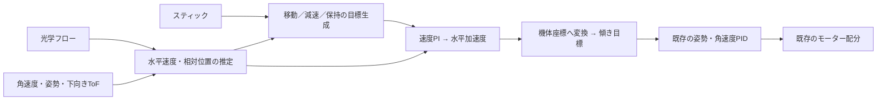

# 光学フローによる水平補正の検討

更新: 2026-10-17。対象: **StampFly_IMU400.slx**。この資料は当初の検討記録です。その後、移動中の速度制御・制動・停止位置保持を実装し、モデル検証しました。現在の操作・設定と検証範囲は[水平補助](horizontal_control.md)を参照してください。

**実現可能です。既存の姿勢・角速度PIDの外側に、水平速度のPI制御と位置のP制御を加える構成を推奨します。** 先に速度制御で停止・移動を確認し、その後に位置保持を有効にします。高度推定の置き換えや大きなEKFの追加は、この段階では必要ありません。

## 操縦したときの動き

| 操作・状態 | 推奨する動作 |
|---|---|
| 右スティックが中立 | 風や機体の偏りによる移動を打ち消し、その場所を保持 |
| 右スティックを前後・左右へ倒す | 機体の前後・左右方向の**速度**を指令。入力に応じた速さで移動 |
| スティックを離す | 速度目標を滑らかにゼロへ下げ、減速してから**停止位置を新しい保持目標**として記憶 |
| 移動後に中立 | 移動前の場所へ戻らず、新しい停止位置にとどまる |
| 中立でYawを操作 | 保持場所を固定したまま向きを変える |
| 移動しながらYawを操作 | 指令する前後・左右は現在の機首方向に追従し、加速度制限で急な変化を抑える |
| Sport／Manual Altitude／水平補助OFF | 現行の操縦方式を使う |

水平補助中は、従来の「スティックから傾き角度を作る」経路を水平速度制御の出力に切り替えます。従来の角度指令へ位置補正を単純に足すと、保持目標へ戻す力が移動操作と競合します。操作中は古い位置目標を解除する方式が、学生にも説明しやすいと考えます。

## 既存制御と操作性への影響

姿勢・角速度・高度の7 PIDの計算式や係数、測定値の経路、モーター配分は維持できます。**変えるのは姿勢PIDへ渡すRoll／Pitchの目標角度であり、移動中もホバリング中も影響します。** 目標角度が変わればPIDの誤差入力、角速度目標、モーター補正も変わります。PIDを残すことと、飛行応答が同じであることは別です。

| 状態 | 現行Stabilize | 水平補助案 |
|---|---|---|
| 移動中 | スティックに応じた傾き目標を維持。速度は外乱や操縦時間でも変わる | スティックに応じた速度目標へ追従するため、加速時と定速時で傾きが変わる |
| 中立でホバリング | 中立の傾き目標。水平の流れを直接は抑えない | 位置・速度のずれに応じて小さな傾きを作り、流れを抑える |
| スティックを離した直後 | 中立の傾きへ戻る | 制動する傾きを作り、停止後にその場所を保持する |

送信機の通信形式・生スティック値は変えず、機体内での解釈を変えます。操作感は「傾きを保つ」から「指定の速さで移動し、中立で止まる」へ変わります。50 Hzの観測・平滑化により外側ループの応答は400 Hzの姿勢制御より遅くなるため、加速度・傾き・目標変化率を制限し、切替は徐々に行います。傾きによる鉛直推力の変化と配分飽和も確認し、既存高度制御の係数を残したまま成立する範囲を先に検証します。

移動中の従来の傾き操作を維持する「中立後だけ補助」という案も可能ですが、今回は**移動中も速度を制御する構成**を採用する方針です。移動の速度と停止を同じ制御で扱え、将来の自動移動にもつなげやすくなります。

## 将来の自動飛行との関係

移動中も水平制御を使えば、手動時はスティック、自動時は経路・軌道の生成処理から目標を受け取り、同じ速度制御と姿勢PIDで移動できます。自動時には位置目標と予定速度から速度指令を作り、加速度制限、停止、観測異常時の解除を共通で扱えます。

```text
手動: スティック → 速度目標 ─────────┐
自動: 位置・軌道目標 → 速度目標 ────┤→ 水平速度制御 → 傾き目標 → 既存PID
```

中立時だけの補助でも、自動移動用の制御を別に追加すれば自動飛行は可能です。ただし、移動中に傾きだけを指令する方式では、外乱や機体の偏りによる速度・到達位置のずれを修正できません。将来の拡張を考え、操縦入力の解釈と速度目標の生成を、水平速度制御から分けて設計します。自動飛行の実装は今回の対象に含めません。

## Yaw補正は水平制御の後に追加する

ユーザーとの確認により、**まず水平速度制御・位置保持、その後に磁気によるYaw推定補正と方位保持**の順で進めます。短時間の相対的な水平保持には磁北への一致は必須でなく、機体が旋回しても同じ座標変換で速度観測と指令を扱えば水平制御を構成できます。ゆっくりした実機旋回と推定Yawのずれは、水平制御の試験に含めます。

現行はYaw角度を保持する外側ループがなく、スティックからYaw角速度目標を直接作ります。現在の磁気センサーは表示・記録用です。後段では次の2つを分けて追加します。

1. **Yaw推定の補正:** 校正した磁場と姿勢から方位を求め、ジャイロで積分した向きのずれをゆっくり補正する。
2. **方位保持:** Yawスティックを離した向きを目標として記憶し、方位誤差からYaw角速度目標を作って既存YawRatePIDへ渡す。操作中は意図した旋回を許す。

磁気で推定値を直すだけでは、目標方位へ戻す機能にはなりません。BMM150のセンサー内部補償と、機体の磁気オフセット・歪みの校正も別です。モーター電流、機体部品、床や周囲の金属の影響を確認してから補正を有効にします。水平制御と同時に変更すると、その影響とフロー・制御の調整を切り分けにくいため、段階を分けます。

後でYawの推定基準を直す際は、速度・位置・保持目標が同じ局所座標を使うよう管理し、基準変更だけで機体が移動を指令されないようにします。時間とともに増えるYaw誤差が水平試験の成立を妨げる場合は、位置保持の範囲を広げる前にYaw補正を優先します。長い自動移動では、安定した方位に加え、光学フロー積分の位置誤差を減らす位置観測も検討します。

## 制御の構成



保持中だけ、位置誤差のP制御から速度目標を作ります。移動中はスティックから速度目標を作り、減速中は速度目標をゼロへ向けます。位置側はP、速度側はPIとし、光学フローの量子化ノイズを増幅する微分項は最初は使いません。

光学フロー・角速度の区間集計は400 Hz、水平推定・制御は50 Hzを第一候補にします。既存の400 Hz姿勢制御へは傾き目標を保持して渡します。XYZや水平2軸はベクトルで扱い、機体座標と局所座標の変換を境界へまとめます。

## 現行処理で先に改善するところ

保存モデルを調べたところ、**OpticalFlowSensor → OpticalFlowDistance50 → ログ**につながっており、水平制御への帰還はありません。内部の距離換算は [imu.FlowDistance50](../code/+imu/FlowDistance50.m) です。

| 現行処理・注意点 | 制御へ使う前の対応 |
|---|---|
| 換算は両軸385 count/rad。PX4にも同じ初期係数があるが、この機体では未校正 | 模様のある床で既知距離の移動と回転を測り、軸の向きと両軸の係数を校正 |
| 20 msの累積カウントを、最後の角速度×20 msで補正 | **同じ時間区間の角速度積分**で回転成分を除去。読み出し時刻・フィルター遅延も確認 |
| 区間内の品質は最後の1サンプルだけで判定。累積値は低品質の差分も含む | 各400 Hzサンプルの品質と有効時間を集計し、条件を満たす区間だけ速度観測として公開 |
| Raw8のvalidはドライバーが初期化・読み出しされたことを示す | SQUAL、外れ値、更新時刻、ToFの状態・経過時間を別に評価。validだけで追跡成功としない |
| 品質条件は「SQUAL≥25 **または** shutter上位バイト<31」 | 床・照明ごとのログで品質判定を決める。シャッター値だけで良否を決めない |
| 無効区間は位置表示が止まり、その間の移動は失われる | 表示停止を速度ゼロとして使わない。推定の有効性を明示し、保持目標を復帰時に取り直す |
| IMU Filterと制御には軸交換・Z反転・Yawの180°オフセットがある | 機体の前・右・下を定義し、フロー→速度→傾き→モーターの符号を机上確認 |
| ToFは非同期で、測距時間設定は33 ms | 50 Hzごとに新しい距離が来るとは仮定せず、距離の時刻を管理して時間を合わせる |

現在PIDに使っているバイアス補正済み機体角速度は、回転補正の候補にできます。ただし、フローと角速度の遅延差が残ると、機体を傾けた動きを水平移動と誤認します。推定器の生クォータニオンや表示用の姿勢変換を、そのまま新しい制御座標として扱うことも避けます。

初期高度0.5 mでは、1 countは約**1.3 mm**、20 msで速度に換算すると約**0.065 m/s**です。小さな速度のノイズが目立つため、区間集計と控えめな平滑化が必要です。平滑化を強くしすぎると減速が遅れます。

## 使える条件と測定が途切れたとき

初期対象は**Stabilize＋Auto Altitude、平らで模様のある床、通常の室内照明、0.3～0.8 mの高さ**とします。最初の試験値は最大速度0.3 m/s、加速度上限0.6 m/s²、傾き上限10°程度を候補とし、校正と試験で調整します。これらは性能保証や確定した設定値ではありません。

離陸直後と接地付近は補助を無効にし、十分な高さ・有効な測定が続いてから滑らかに有効化します。着陸中は既に有効な保持を高さの範囲内で継続し、床へ近づいたら解除します。

測定が無効になったら、その時点から速度PIの積分を止め、短い欠測を超えた場合は水平補助を減らして従来のStabilizeへ戻します。スティック操作は引き続き反映します。測定が安定して復帰し、スティックが中立になってから現在位置を新しい基準にし、過去の目標へ急に戻す挙動を防ぎます。補助の有効・無効と解除理由はログ・アプリに表示する設計にします。

光学フローは床の画像の変化から**速度**を測るため、積分した位置には誤差が蓄積します。磁気を姿勢推定に融合していない現状ではYawも徐々にずれます。この構成は短時間の相対的な位置保持に向いていますが、同じ床の一点を無期限に保持する保証はできません。その必要が生じたら、画像の特徴点、外部カメラ、UWB等の位置観測を追加する段階になります。

## 実装と確認の順序

1. 軸・符号・換算係数・回転補正・ToFの時間合わせを校正し、制御へ接続せず推定速度を記録する。
2. 単体・閉ループシミュレーションで、移動、中立、Yaw、欠測、飽和と復帰を確認する。
3. 既存PIDの外側に**速度制御だけ**を有効にし、移動操作と中立時の減速を確認する。
4. 位置P制御を追加し、停止位置の保持、移動後の基準変更、着陸・欠測を確認する。
5. 水平制御の確認後、磁気の校正・有効性を調べ、Yaw推定補正と方位保持を別段階で追加する。

飛行試験では、フローを積分した位置ログだけで精度を判定せず、床の目印と動画等で実際の位置を測ります。初期の目標案は、0.5 m高度で20秒間の保持誤差を概ね半径0.2 m以内、0.3 m/s移動から中立後1.5秒以内の減速です。実測に応じて目標と係数を見直します。

なお、現行版のUSB机上記録では400 Hz処理の最大が**2,561 µs**、2,500 µs超過が6,000周期中3回ありました。水平処理の追加後は最大処理時間と周期欠落を測り、50 Hz実行周期が既存処理と重なっても成立することを確認します。

詳細案: [要求・動作条件](specs/algorithms/horizontal-hold/horizontal-hold-system.md)／[構成・式](specs/algorithms/horizontal-hold/horizontal-hold-architecture.md)／[実装手順](specs/algorithms/horizontal-hold/horizontal-hold-implementation-plan.md)／[試験計画](specs/algorithms/horizontal-hold/horizontal-hold-test-plan.md)。[今回の調査記録](specs/algorithms/horizontal-hold/horizontal-hold-review-evidence.json)

## 参考資料

- [PX4 Optical Flow](https://docs.px4.io/main/en/sensor/optical_flow.html): 距離を使った速度推定、回転成分と角速度積分の一致、取り付け位置の扱い。
- [PX4 Position Mode](https://docs.px4.io/main/en/flight_modes_mc/position.html): 操作中の移動と中立時の減速・保持。現在のPX4既定は加速度指令であり、本案は速度指令＋加速度制限を選びます。
- [PX4 PMW3901](https://docs.px4.io/main/en/sensor/pmw3901.html)／[PMW3901ドライバー](https://github.com/PX4/PX4-Autopilot/blob/main/src/drivers/optical_flow/pmw3901/PMW3901.cpp): 385 count/rad、品質・実測時間の集計、最小測距距離の参考値。
- [Crazyflie Flow deck処理](https://github.com/bitcraze/crazyflie-firmware/blob/master/src/deck/drivers/src/flowdeck_v1v2.c): 取り付け軸の変換、外れ値除去、品質・シャッターによる観測ノイズ調整の例。符号や閾値は機体へそのまま移植しません。
