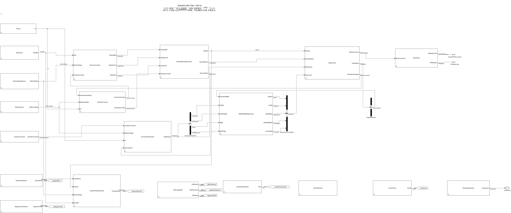

# 現行IMUモデルの読み方

**[StampFly_IMU400.slx](../StampFly_IMU400.slx)** が現行の機体実装です。姿勢はMathWorksの **[IMU Filter](https://jp.mathworks.com/help/nav/ref/imufilter.html)**、高度はMATLAB Functionの **AltitudeKalman**、制御は7個のPIDで構成しています。基本周期は400 Hzです。設定・書き込みは[セットアップ](setup.md)、過去の比較や飛行報告は[履歴](history/README.md)へまとめています。

## 最上位から読む

| 開く場所 | 役割 |
|---|---|
| TickStart | 周期開始時刻、実測dt、時刻の秒変換とGoto公開 |
| IMUSensor／BottomRangeSensor／BatterySensor | 生センサー値の取得。ToFにはMode入力がありません |
| SensorCorrection | 軸・単位変換、800周期の静止校正、IMU平滑化、ToF保持・外れ値処理 |
| AttitudeAltitudeEstimation | 姿勢・高度・鉛直速度推定、センサーフラグ、推定結果のログ公開 |
| CommandPreparation | JoyStick、電池、センサーフラグ、dtを操縦入力バスへまとめる |
| OfficialFlightSupervisor | 最上位Stateflow。校正・待機・飛行・着陸の判断 |
| FlightControl | 離着陸指令、7 PID、モーター配分、飛行状態、次周期フィードバック |
| MotorWrite | [FR, FL, RR, RL]の8 bit指令を150 kHz指定PWMへ適用 |
| DataLogging50 | 生値・推定・制御・追加センサーを50 Hzのログへまとめる |
| JoystickFeedback40／LEDAndBuzzer／CycleTiming | 送信機画面、機体表示、処理時間の観測 |

主要ブロックの端子名と日本語説明から内部をたどります。マスク付きブロックは、右クリック **［マスク］→［マスク内を表示］** で開けます。MATLAB Functionはダブルクリックでコードを開くと、最初の概要と機能別コメントを読めます。Systemブロックは設定画面の冒頭にも日本語説明があります。

## 配列の順序と単位

| 信号 | 順序・単位 |
|---|---|
| 生IMU | センサーXYZの3×1、加速度m/s²、角速度rad/s |
| 校正・平滑化後IMU | 機体XYZの3×1、加速度g基準、角速度rad/s |
| 校正Offset4 | [角速度X, Y, Z, 加速度Z] |
| IMU Filter入力 | 推定器座標[Y, X, −Z]の1×3、加速度m/s²・角速度rad/s |
| 制御用Angles | [Roll, Pitch, Yaw]の3×1、rad |
| 姿勢Quaternion | [w, x, y, z]の4×1 |
| モーターDuty／Counts | [FR, FL, RR, RL]の4×1、Countsはuint8 |
| 光学フロー移動距離 | [東, 北]の2×1、m。表示・記録専用 |
| 磁気 | センサーXYZの3×1、µT。表示・記録専用 |

IMUの6個の成分別フィルターは、**AccelLowpassXYZ／GyroLowpassXYZ** の2個のベクトルフィルターにまとめています。平滑化とバイアス減算ではXYZの順を保ちます。センサー取り付けとIMU Filterの座標・行列形式を合わせる変換は残しています。

## IMU Filter

**AttitudeAltitudeEstimation → IMUAttitude → FusionState → UpdateWhenReady → IMU Filter** を開きます。

| パラメーター | 設定 |
|---|---|
| Reference frame | NED |
| Orientation output format | quaternion |
| Decimation factor | 1 |
| Initial process noise | `IMUFlight.InitialProcessNoise` |
| Accelerometer noise／Gyroscope noise | `IMUFlight.AccelerometerNoise`／`IMUFlight.GyroscopeNoise` |
| Gyroscope drift noise | `IMUFlight.GyroscopeDriftNoise` |
| Linear acceleration noise／decay factor | `IMUFlight.LinearAccelerationNoise`／`IMUFlight.LinearAccelerationDecayFactor` |
| Simulate using | Code generation |

`scripts/setup/init_imu_flight.m`で`imufilter`の既定値を初期化します。実機の振動に合わせたノイズ調整は、ログを取得して評価しながら行います。設定画面の式を数値へ変更すればモデルへ保存できます。

**FilterInputs** は加速度・角速度を[Y, X, −Z]へ変換し、加速度をgからm/s²へ換算します。**FlightOutputs** は姿勢を従来制御の軸・ヨーオフセットへ戻し、角速度も[filterY, filterX, −filterZ]へ戻します。PIDには**IMU Filterのバイアス補正済み角速度**を渡します。静止校正後に残るオフセットを推定して差し引くためです。

FusionStateはMode 0・1で推定を停止するEnabled subsystem、UpdateWhenReadyは再開時に推定状態を初期化するResettable subsystemです。停止中のリセット要求はFilterInputsが記憶します。実行とリセットの役割が異なるため、この2つの階層は保っています。

## 高度推定とToF

**AttitudeAltitudeEstimation → AltitudeKalman** をダブルクリックすると、予測・補正・リセットを1つのMATLAB Functionで読めます。状態は **[鉛直速度; 高度; 加速度バイアス]**、観測は保持・平滑化済みの下向き距離です。加速度入力は従来実装のg基準、dtは実測値です。

予測共分散、ゲイン、観測分散`(0.004 m)²`の更新順序は公式実装を維持しています。待機リセットで公開出力と共分散を初期化し、内部の推定状態を保持する処理もコメントで説明しています。標準Kalmanブロックの比較版は[archive/kf400](../archive/kf400/README.md)です。

**BottomRangeSensor → BottomToFSource** は、初期化・ウォームアップ後にModeに依存せず取得します。新規結果でFreshが1になり、結果のない周期は最新値を返します。割り込み、最小取得間隔、ワーカー実行中の確認、I2C排他を保ち、400 Hzの制御は読み出しを待ちません。前方ToFは未使用です。

センサーの取得と推定で使う条件は別です。**SensorCorrection → ToFHoldOutlierFilter** のMode 0・1での保持や、推定・制御の実行条件は残しています。校正中に生ToFが更新されても、制御の積分状態を進める構成にはしていません。

## PIDと残した階層

**FlightControl → TakeoffHoverControl** から、次の制御へ進みます。

| 制御 | PID |
|---|---|
| AltitudeControl | AltitudePID → VerticalSpeedPID |
| AttitudeControl | RollAnglePID／PitchAnglePID |
| BodyRateControl | RollRatePID／PitchRatePID／YawRatePID |

各PIDを開くと **DedicatedPID** があります。設定画面で係数を変更し、**［適用］→［OK］→ Ctrl+D → 保存 → 再ビルド**。Ideal形式、離散、外部dt・Reset、台形積分と微分フィルターを使います。

余分な外側ラッパーは削除し、PIDのEnabled境界を直接表示しています。**EstimatorContext／PreviousCycle** の前周期保持は更新順序と代数ループ回避に必要です。モーター配分は機能単位でまとめ、[FR, FL, RR, RL]の順を出力・ログでも保ちます。

## Goto／Fromでログをたどる

| タグ | 内容 |
|---|---|
| LogOpticalFlow | PMW3901の差分・品質・累積カウント |
| LogMagneticField | BMM150の磁場・状態・診断 |
| LogFlowDistance50 | 東・北移動距離、使用フラグ、移動量 |
| BottomDistanceMm／BottomRangeFresh／BottomRangeStatus／BottomToFDiagnostics | 下向きToFの生値・更新・状態・診断 |
| AttitudeAngles／AttitudeQuaternion／FilteredAngularRate | 姿勢とPIDへ渡す角速度 |
| EstimatedAltitude／VerticalVelocity | 高度・鉛直速度 |

DataLogging50の **ReadLogMagneticField** などをダブルクリックし、**Goto source** から出所を確認します。**Ctrl+F** でタグ名を検索する方法もあります。Goto／Fromは周期遅れを追加しません。50 Hzなどへの保持は明示したRate Transition・保持ブロックで行います。

表示名の不要な`400`は取り除いています。モデルファイル名、Systemクラス名、生成コードで参照する識別子は互換性のため残しています。ログのBuildIDは1401で、機体固有IDではありません。旧名の`RawMadgwickQuaternion`診断には現在のWXYZ姿勢が入ります。
